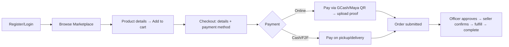
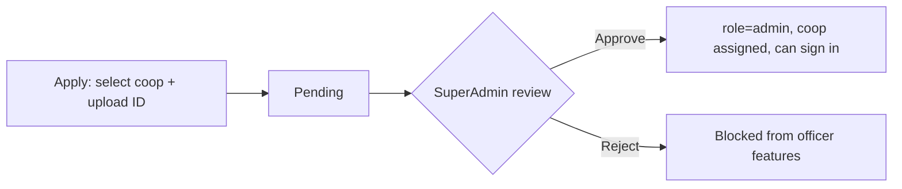
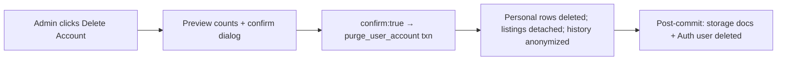

# AgriCoop Marketplace — Complete System Documentation

> Based on the actual implementation in this repository. For per-file detail see `AGRICOOP_FILE_BY_FILE_REFERENCE.md`; for setup see `AGRICOOP_DEVELOPER_SETUP.md`; for role instructions see `AGRICOOP_USER_GUIDE.md`.

## 1. System overview

**AgriCoop Marketplace** is a cooperative-centered web marketplace for agricultural products in the Philippines (Agusan del Sur / Caraga region, Butuan City and beyond). It connects individual farmers/sellers, buyers, cooperative officers, and platform administrators in one application.

### Problems addressed

- Fragmented agricultural trade — farmers lack direct market access; buyers cannot verify product origin.
- Need for cooperative oversight — orders, payments, and disputes need a trusted intermediary.
- Payment trust — online wallets (GCash, Maya, MariBank, GoTyme) are common but buyers need proof-of-payment workflows.
- Verification — sellers and cooperative admins must prove identity before gaining elevated access.

### Intended users / roles

| Role | Who | Access |
|---|---|---|
| `buyer` | End customers | Browse, cart, order, pay, message, support |
| `seller` | Farmers/producers | Everything a buyer can do, plus listings, fulfillment, quotations |
| `admin` | OfficerAdmin — one cooperative's officer | Cooperative-scoped member/listing/order/payment/report management |
| `superadmin` | Platform operator | Everything, platform-wide, plus applications review and user deletion |

### Core functionality

- Public marketplace browsing, search, filters, product details, favorites.
- Server-side cart, checkout with multiple payment methods (online wallets with QR + proof upload; cash/F2F).
- Order lifecycle: submit → officer approval → seller availability confirmation → fulfillment → completion/cancellation.
- Quotations for order-based/custom produce.
- Cooperative admin application workflow with private government-ID upload and SuperAdmin review.
- Profile verification documents (private storage, officer review).
- Messaging (order-scoped and direct conversations), notifications with realtime invalidation.
- Support tickets with threaded replies.
- Reports + CSV export, audit logs, system health panel.
- Permanent account deletion with anonymized history retention.

### Architecture

```
Browser (React 19 + Vite + TS)
   │  tRPC over HTTP (/api/trpc/*), Supabase Auth (JWT), Supabase Storage (via proxy)
   ▼
Express server (server/_core/index.ts)
   ├─ tRPC routers: server/routers.ts + server/part2Routers.ts
   ├─ authz helpers: server/authz.ts, orderAccess.ts, marketplaceRules.ts
   ├─ storage proxy: server/_core/storageProxy*.ts
   └─ Drizzle ORM → PostgreSQL (schema agricoop_app) with RLS + security-definer functions
```

- **Frontend:** React 19, TypeScript, Vite, Wouter routing, TanStack Query (via tRPC client), Tailwind + shadcn/ui components, custom design system (`agri-*` classes, green/earth palette).
- **Backend:** Node/Express (`server/_core/`), tRPC, Drizzle ORM, `postgres` driver. Runs as a single Node process locally; serverless via `api/index.ts` + `dist/vercel-api.js` on Vercel.
- **Database:** PostgreSQL (Supabase). Schema `agricoop_app` holds all app tables; `public.profiles` mirrors Supabase auth profiles. RLS + `SECURITY DEFINER` functions enforce row-level rules even when queries run as `authenticated`.
- **Auth:** Supabase Auth (email/password, email verification, password recovery). App-level role resolution maps the Supabase identity to `agricoop_app.users`.
- **Storage:** Supabase Storage buckets — `product-images` (public-ish via proxy), `profile-verification-documents` and `coop-admin-applications` (private, access enforced by `storageProxyAuth.ts`).
- **Realtime:** Supabase Realtime + client-side invalidation (`useRealtimeInvalidation`) for notifications/messages.

## 2. Roles and permissions

### Role model

- `users.role` ∈ `buyer | seller | admin | superadmin`.
- `users.approvalStatus` ∈ `approved | pending | suspended` — pending/suspended accounts cannot use role features.
- OfficerAdmins (`admin`) are bound to exactly one `cooperativeId`; every query is filtered by it.
- SuperAdmins see all cooperatives and all users (except other superadmins for destructive ops).

### Permission matrix (summary)

| Capability | Buyer | Seller | OfficerAdmin | SuperAdmin |
|---|---|---|---|---|
| Browse marketplace | ✓ | ✓ | ✓ | ✓ |
| Cart / checkout / orders | ✓ | ✓ | view own coop | view all |
| Create/edit own listings | — | ✓ | moderate coop listings | moderate all |
| Approve orders | — | confirm availability | ✓ coop orders | ✓ |
| Verify payments | upload proof | upload proof | ✓ coop proofs | ✓ all |
| Manage members | — | — | ✓ coop (buyer/seller) | ✓ all non-superadmin |
| Review coop-admin applications | — | — | — | ✓ |
| Payment options per coop | — | — | ✓ | ✓ |
| Reports | own | own | coop | platform |
| Audit logs | — | — | — | ✓ |
| Permanently delete user | — | — | coop buyer/seller only | all except superadmin/self |

Detailed enforcement lives in `server/authz.ts` (`canSoftDeleteTargetUser` — historical name for the permanent-delete guard), `server/orderAccess.ts`, and per-procedure checks in the routers.

## 3. Feature documentation

### 3.1 Authentication & accounts

- **Register:** `client/src/pages/Auth.tsx` — email/password registration; separate path for Cooperative Admin applications (`/applications/cooperative-admin`, `CoopAdminApplication.tsx`) which captures cooperative selection + private ID upload.
- **Login:** Supabase `signInWithPassword`, then `resolveApplicationSession` calls `auth.status` + `auth.me` to resolve role/approval; handles email-verification, deleted/missing/mapping-conflict states with user-facing toasts.
- **Password recovery:** Supabase recovery link → `/auth` reset stage.
- **Session:** `client/src/lib/authSession.ts` wraps `supabase.auth` session events; server validates the JWT per request.
- **Profile:** `/profile` (`Profile.tsx`) — contact details, profile image upload (`profileImage.ts`), verification document submission (`profileVerification.ts`).
- **Permanent deletion:** `admin.deleteUser` (see §3.12).

### 3.2 Cooperatives

- Cooperatives are first-class entities (`cooperatives` table): name, slug, location, status, `deletedAt` soft-delete.
- Public pages: `/cooperatives/:slug` (`CooperativePage.tsx`) lists a coop's public profile/listings.
- SuperAdmin manages creation/edit/status via dashboard `cooperatives` section (`CooperativesAdminPanel` in Dashboard.tsx).
- Sellers must be associated with a cooperative; association requests go through officer review (`cooperativeAssociations.ts`, `SellerAssociationRequestPanel`).

### 3.3 Product listings

- Sellers create/edit listings in the Farmer workspace (Dashboard.tsx seller sections): name, category/classification, variety (datalist suggestions), price/unit, stock, min order qty, quality grade, fulfillment type (`on_hand` ready stock vs `order_based` made-to-order), payment flags (pickup/delivery/online), images via `ProductImagePicker`.
- Listing lifecycle statuses: `verificationStatus` (pending/approved/rejected), `visibility` (visible/hidden), `deletedAt` archive. OfficerAdmin moderation queues exist per cooperative.
- Images stored via `products.uploadImage` → Supabase Storage; served through storage proxy.

### 3.4 Marketplace

- `/marketplace` (`Marketplace.tsx`): product grid, search, category/cooperative filters, sorting, pagination; anonymous browsing allowed (RLS policies permit public read of approved listings).
- `/products/:id` (`ProductDetails.tsx`): gallery, price/stock, seller/coop info, add-to-cart, favorite, quotation request, message seller.

### 3.5 Cart & checkout

- Server-side cart (`cart.ts`, `cartItems` table) plus localStorage leftovers merge (`useBuyerCart.ts`).
- `/checkout` (`Checkout.tsx`): fulfillment selection first (`pickup`/`delivery`), then payment method filtered to compatible options, conditional delivery details, order submission → `orders` + `orderItems` + `transactions` rows; mixed-cart (multi-seller) orders split per cooperative/seller.
- **Fulfillment vs. payment are independent attributes.** `orders.fulfillmentMethod` stores `pickup`|`delivery`; `orders.paymentMethod` stores `cash_pickup`|`cash_delivery`|`online` (legacy `gcash`/`f2f` normalized on read/write). Valid combinations: pickup+online, delivery+online, pickup+cash_pickup, delivery+cash_delivery. `paymentMethodsForFulfillment`/`fulfillmentOptionsForListings` in `shared/paymentMethods.ts` drive the UI; `orders.create` re-validates compatibility, delivery-address completeness, online-account readiness, and receipt proof server-side. Fulfillment is displayed (never inferred from payment for new orders) on checkout, order lists/details (`OrderDetail.tsx`), seller queues, officer payment verification, Dashboard, and Reports.

### 3.6 Orders & fulfillment

- Order statuses: `submitted → confirmed → ready → completed` (+ `cancelled`).
- OfficerAdmin approves submitted orders; seller confirms availability (`sellerConfirmationStatus`) for order-based items; officer completes after fulfillment/payment.
- Buyers track via `/activity`, `/orders/:id` (`OrderDetail.tsx`); sellers via fulfillment queue in Farmer workspace; officers via orders section.
- Archive/delete of completed/cancelled orders supported per role with bulk select.

### 3.7 Payments

- Methods defined in `shared/paymentMethods.ts` / `paymentOptions.ts`: canonical checkout methods are `cash_pickup`, `cash_delivery`, and `online` (displayed as "Online Payment"); legacy `gcash`/`f2f` values are normalized for display/compat only.
- **Online payment availability** is platform-level: `systemPaymentSettings.onlineEnabled` must be true AND an active (non-archived, `isActive`) `systemOnlinePaymentAccounts` row with a `qrImagePath` must exist (`getSystemPaymentAvailability` in `server/systemPayment.ts`). If either is missing, `methodsForListings` excludes `online` and checkout hides the option. SuperAdmin manages settings/accounts via `systemPayment.*` procedures (`/dashboard?section=settings` → AdminSystemPaymentsPanel); every change writes `systemPaymentSettingsAudit`.
- Each cooperative may additionally configure `paymentOptions` rows (e.g. a cooperative GCash account + QR) via `/admin/payment-options` (`PaymentOptions.tsx`, `adminPayment.*` procedures). These are scoped per cooperative and consumable through `adminPayment.checkoutOptions` (validates basket cooperative + product eligibility); they are an optional alternative rail — canonical checkout "online" uses the platform AgriCoop account.
- Online payment: buyer sees the AgriCoop QR + account details (`systemPayment.getCheckoutOnlineDetails`, buyer-only) → pays externally → uploads receipt (`payments.uploadProof`/`finalizeProofUpload` into private `payment-proof` storage) → order created with `paymentStatus=awaiting_verification` → officer verifies → `paid`/`verified`. `paymentProofs.ts`, `paymentRefunds.ts`, `systemPayment.ts` implement the lifecycle.
- **Buyer dashboard "Online payments" section** lists `online`/`gcash` transactions with proof upload/status (previously filtered to legacy `gcash` only, hiding canonical `online` orders).

### 3.8 Messaging & notifications

- Conversations + messages (`realtime.ts`, Messages.tsx): order-scoped threads (buyer↔seller, buyer↔officer, seller↔officer) and direct threads; access enforced by `orderAccess.ts`/participant checks.
- Notifications table + bell (`NotificationBell` in AgriShell) + sidebar pending-count badges (`usePendingCounts.ts`, `adminNavBadges`). Realtime invalidation refreshes lists.

### 3.9 Support

- Support tickets + threaded replies (`supportTickets.ts`, `Support.tsx` buyer-facing, `SupportTickets.tsx` admin). Status workflow via `SupportTicketStatusSelect`.

### 3.10 Reports & audit

- `Reports.tsx` — role-scoped metrics and CSV export (`shared/reportCsv.ts`).
- `AuditLogs.tsx` — SuperAdmin audit trail (`auditLogs` table, server-only writer per migration `20261118290000`).

### 3.11 Security model

- Every tRPC procedure is `protectedProcedure`/role-checked; mutations validate with zod.
- DB requests run inside transactions as `SET LOCAL ROLE authenticated` so **RLS policies apply**; security-definer helpers (`agricoop_app.*`) perform privileged writes (audit log, order locks, quotation locks, purge).
- Private storage enforced by `storageProxyAuth.ts` — signed URLs only for authorized participants.
- Rate limiting and input validation on auth/payment paths (`paymentSecurity.test.ts`, `authLoginLookup`).

### 3.12 Permanent account deletion

`admin.deleteUser({ userId, confirm: true })`:

1. Guard: `canSoftDeleteTargetUser` (historical name) — blocks self-delete, superadmin targets, officer-on-officer, out-of-coop targets.
2. `userDeletePreview` reports listing/order counts for the confirmation dialog.
3. `agricoop_app.purge_user_account(userId, actorId)` SECURITY DEFINER function atomically deletes personal data: user row, conversations/messages, tickets, notifications, cart, thread states, coop-admin applications, verification docs metadata, quotations, association requests; **detaches listings** (`sellerId=NULL`, archived/hidden) preserving order history.
4. Retained-history FKs (`orders.buyerId/sellerId`, `transactions`, `payments`, `paymentProofs`, etc.) are nullable `ON DELETE SET NULL` → financial records survive anonymized.
5. Post-commit: private documents removed from both buckets (3 retries), Supabase Auth user deleted (3 retries); `public.profiles` removed via auth cascade.
6. `cleanupWarnings` reports any post-commit cleanup that needs attention.

Migration: `supabase/migrations/20261205000000_permanent_user_deletion.sql`.

### 3.13 Cooperative Admin onboarding

- Dedicated registration path (`CoopAdminApplication.tsx` + `server/coopAdminApplication.ts` + `shared/coopAdminApplication.ts`).
- Applicant selects an active cooperative, uploads government ID to private bucket, submits → `coopAdminApplications` row `pending`.
- SuperAdmin reviews in dashboard `applications` section (`OfficerApplicationsPanel.tsx`): approve → sets `role=admin` + `cooperativeId`, `approvalStatus=approved`; reject → blocked from officer features.
- Migration: `20261204000000_coop_admin_application_verification.sql`.

## 4. Key workflows

### Buyer purchase (simplified)



### OfficerAdmin onboarding



### Permanent deletion



## 5. Database

- Engine: PostgreSQL via Supabase; app schema `agricoop_app`; auth schema managed by Supabase; `public.profiles` mirrors auth users.
- ~40 application tables covering: users, cooperatives, products, productImages, cartItems, orders, orderItems, transactions, payments, paymentProofs, paymentOptions, quotations, conversations, messages, notifications, supportTickets(+messages), auditLogs, coopAdminApplications, profileVerificationSubmissions, cooperativeAssociationRequests, threadStates.
- Drizzle schema: `drizzle/pg-schema.ts` (authoritative) + generated `drizzle/schema.ts`, `drizzle/relations.ts`; migrations `drizzle/0000–0011` plus ~45 hand-written `supabase/migrations/*.sql` applied in order.
- RLS: enabled on app tables; policies + grants created across migrations; anonymous browse allowed for approved listings; private tables restricted.
- Security-definer functions (`agricoop_app.*`): audit writer, order/quotation lock helpers, registration guards, `purge_user_account`, health checks.
- Deletion semantics: soft-delete (`deletedAt`) for cooperatives/listings/orders; **permanent** for user accounts with `SET NULL` history anonymization.

## 6. API / backend

- tRPC routers split: `server/routers.ts` (core: auth, products, orders, payments, admin) and `server/part2Routers.ts` (applications, cooperatives, support, reports, messaging extras).
- Context (`server/_core/context.ts`) builds auth session → `authz.ts` resolves application user + role.
- Error mapping: `shared/userFacingErrors.ts` converts technical errors to plain language.
- Realtime: Supabase Realtime channels + `useRealtimeInvalidation` client hook.

## 7. Frontend

- Routing: Wouter (`client/src/App.tsx`) — public pages + `/dashboard` role router. Heavy routes (including `Marketplace`, `AdminShell`, `Dashboard`, `DashboardAnalytics`) are lazy-loaded; entry chunk ~727 kB / 208 kB gzip after the 2026-11-22 split.
- Shells: `AgriShell` (public header, mobile bottom nav + slide-over menu, notification bell, cart link), `AdminShell` (shadcn sidebar for admin/superadmin with pending badges), role workspaces inside `Dashboard.tsx`.
- Design system: Tailwind + custom `agri-*` utilities (`index.css`), `field-label`/`field-control`/`agri-button`/`agri-card`/`agri-ghost`/`agri-danger` classes; StatusPill, Empty states, skeletons.
- State: TanStack Query via `lib/trpc.ts`; auth via `useAuth`/`authSession`.

## 8. Installation

See `AGRICOOP_DEVELOPER_SETUP.md`. Summary: `pnpm install --frozen-lockfile` → `.env.local` → apply migrations → `pnpm dev`.

## 9. Deployment & maintenance

- Vercel: `vercel.json` (region sin1, SPA rewrite, immutable asset caching), `api/index.ts` serverless entry, `dist/` build output. Separate dev/preview/prod env vars. See `AGRICOOP_FINAL_DEPLOYMENT_READINESS.md` for the full pre-deploy checklist, migration preflight, and rollback plan.
- Migrations applied manually with owner credentials — never at runtime.
- Backups: Supabase managed backups; local `backups/` dir is protected scratch.
- Monitoring: `/api/health`, dashboard System Health panel, audit logs.
