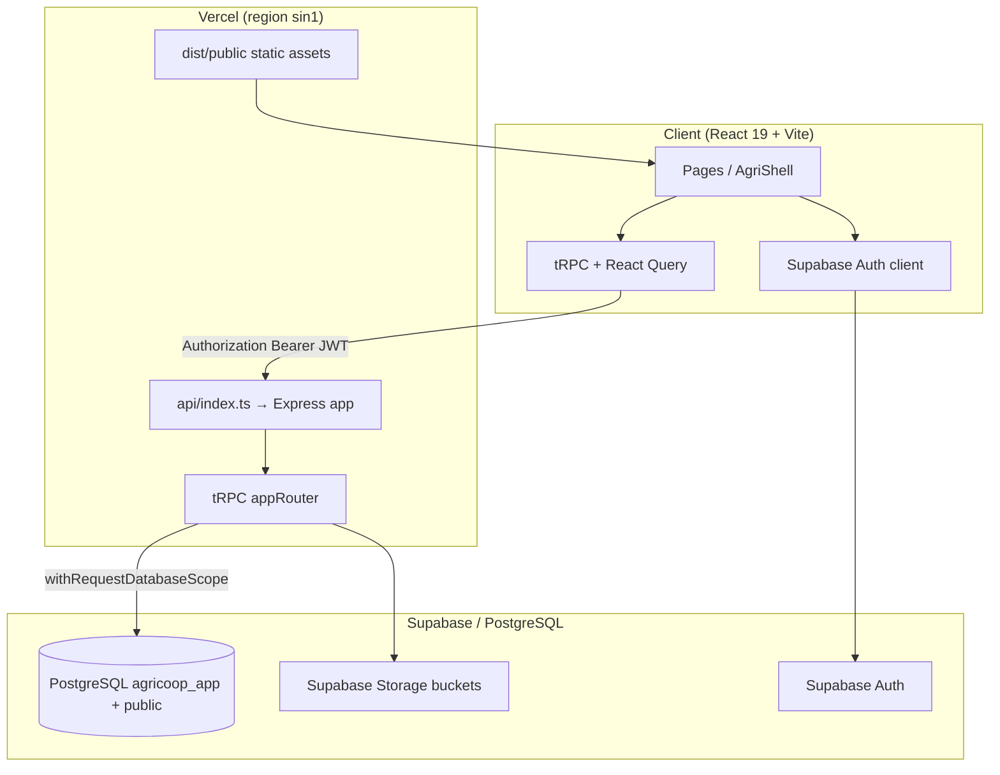
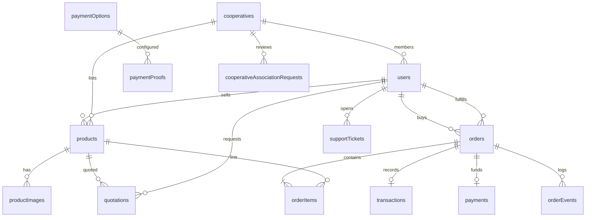
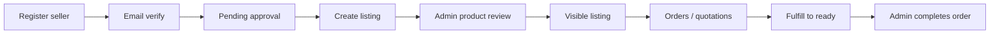
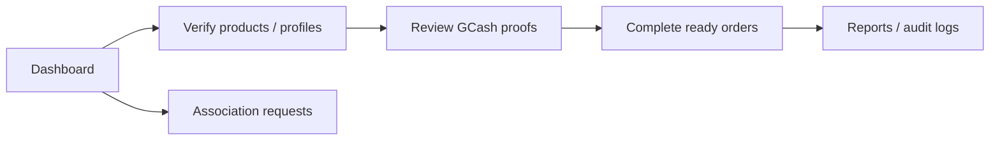
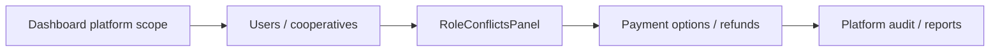
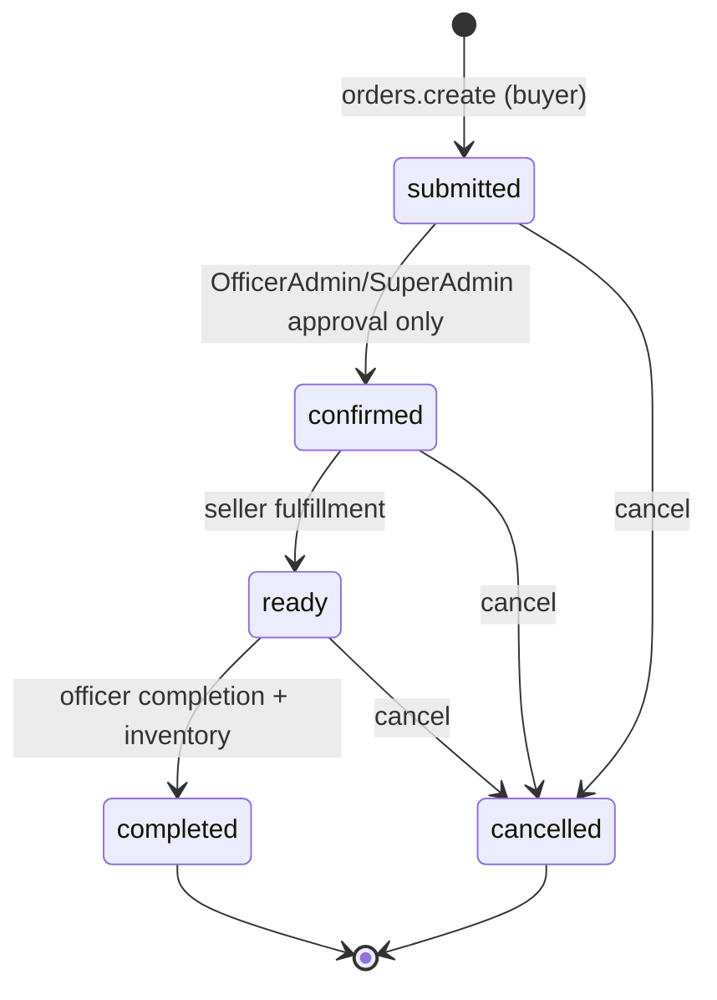

# AgriCoop Marketplace — System Documentation

**Document type:** Capstone / thesis system documentation  
**Software name:** agricoop-marketplace  
**Package version:** 1.0.0  
**License:** MIT  
**Evidence date:** Derived from the repository at documentation generation time  

---

## Table of Contents

1. Title Page and Scope  
2. System Overview  
3. Objectives and Features by Role  
4. System Architecture  
5. Technology Stack  
6. Database Design and Security Model  
7. Role and Permission Matrix  
8. User Journeys  
9. Order Lifecycle State Machine  
10. API Reference (tRPC)  
11. Authorization Design and Role Consistency  
12. User Interface and Experience Design  
13. Security Measures  
14. Testing  
15. Deployment  
16. Performance  
17. Limitations and Future Work  
18. Appendices  

---

## 1. Title Page and Scope

| Field | Value |
|-------|--------|
| System | AgriCoop Marketplace |
| Purpose | Web application connecting agricultural buyers, seller-farmers, cooperative officers, and platform administrators for listing, quotation, ordering, fulfillment, and payment coordination |
| Runtime API | Express-hosted tRPC over HTTP (`/api/trpc`) |
| Client | React single-page application (Vite build → `dist/public`) |
| Primary persistence | PostgreSQL (`agricoop_app` schema) via Drizzle ORM |
| Identity | Supabase Auth (JWT); application accounts in `agricoop_app.users` |
| Hosting configuration | Vercel (`vercel.json`: region `sin1`, SPA rewrites, API function max duration 30s) |

This document describes the implemented system as evidenced in source code, configuration, and project documentation files. No connection strings, secrets, or personal identifiers are reproduced.

---

## 2. System Overview

AgriCoop Marketplace is a cooperative-oriented produce marketplace. Public visitors may browse approved product listings. Registered buyers and sellers trade under approval and verification rules. Cooperative **admin** officers (runtime role `admin`) moderate listings, orders, payments, and members within a cooperative scope. **superadmin** users manage platform-wide configuration, identity reconciliation, and cross-cooperative reporting.

The application does not implement an automated payment gateway. Checkout records **Cash on Pickup**, **Cash on Delivery**, and **Online Payment** (platform QR managed by Admin/SuperAdmin + buyer receipt at order create). Legacy rows may still show `gcash` or `f2f`; new creates normalize Online to `online`. Fulfillment (`pickup`/`delivery`) is stored separately from payment method and remains a per-listing seller option. Online availability is a system setting (`systemPaymentSettings` + active `systemOnlinePaymentAccounts` QR) **and** a per-listing eligibility flag `products.onlinePaymentEnabled` (default `true`, migration `20261203000000_product_online_payment_toggle.sql`). Sellers toggle it in the product create/edit form ("Online payment eligible"); OfficerAdmins may set it via `cooperativeAdmin.setFulfillmentClassification`. `methodsForListings` excludes `online` when any order-group product disables it, and `orders.create` re-validates server-side so forged requests are rejected; mixed carts containing a disabled product never offer online. Offline methods are unaffected. Sellers see payment status as read-only; only Admin/SuperAdmin confirm/reject receipts and mark cash received. Business rules live in `shared/paymentMethods.ts` and `server/systemPayment.ts`; APIs are exposed through `server/routers.ts` as a typed tRPC `appRouter`. Order detail is `/orders/:id`; cooperatives have public pages at `/cooperatives/:slug`.

Authentication uses Supabase-issued bearer tokens. Each API request runs inside a PostgreSQL transaction with session role and JWT claim GUCs set (`server/db.ts`: `withRequestDatabaseScope`, `applyRequestDatabaseSettings`). Row-level security policies in `supabase/migrations/` provide defense in depth alongside procedure-level checks in `server/authz.ts`.

---

## 3. Objectives and Features by Role

Runtime roles are enumerated in `drizzle/pg-schema.ts` as `user_role`: `buyer`, `seller`, `admin`, `superadmin`. Public `profiles`/`roles` tables map product-facing names (`coop_officer` → `admin`, `system_admin` → `superadmin`) per `server/authIdentity.ts`.

### 3.1 Buyer

**Objectives.** Discover verified produce, request quotations, place single-seller orders, track fulfillment, submit profile verification and Online Payment receipts at checkout, and access support channels.

**Implemented features (evidence).**

- Public marketplace browse: `marketplace.list`, `marketplace.categories`, `marketplace.byId`; filters require published, approved, visible listings and approved sellers (`getMarketplace` in `server/db.ts`).
- Basket and checkout on `/marketplace` (`#order` aside) and `/checkout` with `sessionStorage` cart (`docs/UX_AUDIT.md`).
- Quotation request and accept/decline flow: `quotations.request`, `quotations.decide`; place order from accepted quote via `orders.create` rules in `marketplaceRules.ts` (`canPlaceAcceptedQuotationOrder`).
- Order history: `orders.buyerMine`, `orders.buyerMineCounts`, Active/Archived tabs on `/activity` (`?tab=`). Archive/unarchive is per-buyer via `threadStates` channel `order` (`orders.updateArchive`) and never changes seller/admin views, payment, or history.
- Profile and identity verification upload: `account.requestVerificationUpload`, `account.submitVerification`.
- Online receipt submission at checkout and re-upload: checkout receipt intents + `payments.uploadProof` / `payments.finalizeProofUpload`.
- Support conversations: `conversations.*`; support tickets: `support.createTicket`, `support.myTickets`.
- Optional cooperative at signup via searchable `CooperativeSelect` (add-new supported).

Self-registration sets `buyer` with `approvalStatus` **approved** (`resolvePublicRegistrationIdentity` in `server/authIdentity.ts`). Cooperative Admin applicants also start as buyers (see §3.5).

### 3.2 Seller (Farmer)

**Objectives.** Obtain cooperative association, list products for admin verification, fulfill orders through cooperative workflow, respond to quotations, and record cash receipts where applicable.

**Implemented features.**

- Seller product CRUD and image upload: `products.create`, `update`, `submit`, `archive`, `uploadImage` (roles: seller, admin, superadmin with ownership checks).
- Cooperative association request: `cooperativeAssociations.request`, `mine`, `activeCooperatives`.
- Seller order and quotation queues: `orders.sellerMine`, `quotations.sellerMine`, `quotations.respond`.
- Order status transitions: `orders.updateStatus` — sellers may only move `confirmed → ready`; `submitted → confirmed` approval is OfficerAdmin/SuperAdmin-only and gated by stock and seller availability confirmation (see §9).
- Fulfillment status updates only (Mark ready after officer approval). Cash received and receipt verification are Admin/SuperAdmin actions. Seller availability responses use `orders.respondAvailability`.
- Dashboard workspace: `SellerVerificationWorkspace` on `/dashboard` (`docs/UX_AUDIT.md`).

Self-registration sets `seller` with `approvalStatus` **pending** until admin approval.

### 3.3 Admin (Cooperative Officer)

**Objectives.** Govern cooperative members and listings, complete orders with adjustable delivered quantities, verify Online receipts and cash payments (Payments tab), review profile documents, configure system payment methods/QR, and audit activity within cooperative scope.

**Implemented features.**

- Cooperative-scoped overview: `cooperativeAdmin.overview`, `admin.overview` (scoped by `cooperativeId` via `adminOverviewCooperativeScope`).
- Product verification queue: `admin.reviewProduct`.
- User management: `admin.updateUser`, `cooperativeAdmin.updateMemberStatus`, and **Add account** (`admin.createAccount`) for Buyer/Seller (confirmed Auth user + set-password invite; no password shown).
- Association request review: `cooperativeAssociations.reviewAssociationRequest` (router `cooperativeAdmin.reviewAssociationRequest`).
- Order completion with final quantities: `orders.updateStatus` → `prepareOrderCompletion` in `marketplaceRules.ts`.
- Payment and profile verification queues: `payments.reviewProof`, `payments.recordCashReceipt`, `systemPayment.*`, `account.reviewVerification`.
- Payment options CRUD (cooperative scope): `adminPayment.*`.
- Reports CSV exports: `/reports` page.
- Audit log read (cooperative scope): `auditLogs.list` on `/admin/audit-logs`.
- Support ticket staff workflows: `support.listAll`, `assign`, `reply`, `updateStatus`.
- Order-specific OfficerAdmin–Seller messaging: `cooperativeAdmin.openSellerOrderThread` (Seller Confirmation request flow) and `conversations.openOfficerOrderThread` (Seller "Message Officer" action). Threads reuse the conversations table with the officer as `buyerId` participant and the seller as `sellerId`, deduplicated on the exact `(orderId, buyerId, sellerId)` triple; the real buyer cannot read these threads (`canAccessConversation` denies non-participants, verified HTTP 403).
- Pending-activity dashboard cards (`PendingActivitySection role="officeradmin"`): orders to review, awaiting seller confirmation, payment proofs, open tickets — COUNT-only via `notifications.pendingCounts`, hidden at zero.

Public signup may choose **Cooperative Admin** (displayed as Officer Admin) but that path never grants `admin` until SuperAdmin approval (§3.5). Officer Admins retain **global** Admin powers; cooperative-scoped Officer Admin is not implemented (`docs/UX_DECISIONS.md`).

### 3.4 SuperAdmin

**Objectives.** Platform-wide user and cooperative management, role identity reconciliation, global payment configuration, and cross-cooperative reporting and audit.

**Implemented features.**

- Cooperative lifecycle: `cooperatives.create`, `update`, `setStatus` (superadmin only per `server/routers.ts`).
- Role conflict detection and reconciliation: `admin.listRoleConflicts`, `admin.reconcileRole` with UI `RoleConflictsPanel` on `/dashboard`.
- Assign superadmin role only when `canAssignSuperAdmin` permits (`docs/UX_AUDIT.md`). Nobody creates SuperAdmin from Add account UI.
- Add account may also create Officer Admin (`admin`) accounts (`admin.createAccount` + `canCreateManagedAccountRole`).
- Cooperative Admin applications queue: dashboard body tab `?tab=applications` → `officerApplications.pendingList` / `review` / `documentUrl` (SuperAdmin only).
- Unscoped or platform-wide admin overview and audit where queries omit cooperative filter for superadmin.
- Platform-scoped payment options and refund queues: `payments.refundQueue`, `recordRefund`, `updateRefundStatus`.
- Pending-activity cards on the dashboard overview (`PendingActivitySection role="superadmin"`): product reviews, cooperative applications, profile verifications, and user approvals. Counts come from `notifications.pendingCounts` (COUNT-only, role-scoped); cards hide at zero and deep-link to the matching management section (`?section=products|applications|overview|users`).

### 3.5 Cooperative Admin application (no fifth role)

**Registration.** Signup offers Buyer, Seller, and Cooperative Admin. Cooperative Admin is the existing `admin` role, labeled **Officer Admin**. Choosing it creates a Buyer account with `requestedRole = admin` and a `cooperativeAdminApplications` row in `awaiting_documents` — no Admin privilege until approval.

**Applicant flow.** After email verify/login: `/applications/cooperative-admin` (banner on buyer dashboard). Form: full name, cooperative (select/add-new), position, ID image, proof-of-position image (JPEG/PNG/WebP ≤ 5 MB, client compress). Uploads require a session; private bucket `coop-admin-applications` with Auth-user-id path prefix; signed URLs only after server authz for uploader or SuperAdmin.

**Review.** Submit → `pending`. SuperAdmin Approves (sets role `admin`, clears `requestedRole`, audit + in-app notification) or Rejects (reason required; applicant may resubmit). Officer Admins cannot read files or approve; self-approve blocked. Soft states only (records/files kept). Application decision emails: **not sent** — no product transactional email provider beyond Supabase Auth.

**Cooperatives at signup.** Searchable active list + add-new; required for Seller/Cooperative Admin; optional for Buyers. New coops use Part 1 normalize / Did you mean…? / rate limit / `source='user'` / `createdBy` inside the signup transaction (`create_user_cooperative`). Anon has no cooperative INSERT.

---

## 4. System Architecture

The system follows a classic three-tier pattern: browser client, stateless API on Vercel serverless functions, and managed PostgreSQL plus Supabase Auth and Storage.



**Request path.**

1. `client/src/main.tsx` configures TanStack Query and tRPC client; sends Supabase session token on `/api/trpc` requests.
2. `server/_core/context.ts` validates the JWT via `supabaseAdmin.auth.getUser` and resolves the application user through `getUserByVerifiedAuthId` (`server/db.ts`).
3. Procedures in `server/routers.ts` enforce `requireOperationalRole` and resource-specific helpers from `server/authz.ts`.
4. Database access uses Drizzle with `postgres` driver; connection pool `max: 1` per serverless isolate (`server/db.ts`).

**Realtime (support chat).** `server/realtime.ts` provides process-local SSE for conversation messages; `conversations.send` publishes events consumed by `/api/conversations/:id/stream` (`docs/PROJECT_SUMMARY.md`).

---

## 5. Technology Stack

Versions below are taken from root `package.json` unless noted.

| Technology | Version | Purpose | Rationale (where inferable) |
|------------|---------|---------|------------------------------|
| Node.js / pnpm | packageManager `pnpm@10.4.1` | Tooling and dependency management | Declared in `package.json` `packageManager` |
| TypeScript | 5.9.3 | Type-safe client and server | `check` / `lint` scripts |
| React | ^19.2.1 | UI components and pages | SPA in `client/` |
| Vite | ^7.1.7 | Dev server and production bundling | `vite build` in `build` script |
| Wouter | ^3.3.5 | Client-side routing | `client/src/App.tsx` |
| Tailwind CSS | ^4.1.14 | Styling and responsive layout | `@tailwindcss/vite` |
| Radix UI | multiple ^1.x–^2.x | Accessible UI primitives | dependencies block |
| TanStack React Query | ^5.90.2 | Server state caching | tRPC integration |
| tRPC | ^11.6.0 | End-to-end typed API | `server/routers.ts` |
| Express | ^4.21.2 | HTTP server for API and static files | `server/_core/index.ts` |
| Zod | ^4.1.12 | Input validation on procedures | router input schemas |
| Drizzle ORM | ^0.44.5 | PostgreSQL schema and queries | `drizzle/pg-schema.ts` |
| postgres (driver) | ^3.4.7 | PostgreSQL client | `server/db.ts` |
| drizzle-kit | ^0.31.4 | Migration generation helper | `db:generate` script |
| Supabase JS | ^2.116.0 | Auth and Storage SDK | `server/clients.ts`, client auth |
| jose | 6.1.0 | JWT handling (where used in core) | dependency |
| esbuild | ^0.25.0 | Server bundle for production | `build` script |
| Vitest | ^2.1.4 | Unit and integration tests | `pnpm test` |
| Playwright | ^1.65.1 | E2E tests and PDF export script | `@playwright/test`, `build-system-docs.mjs` |
| AWS SDK S3 | ^3.693.0 | Optional S3-compatible storage helpers | `server/storage.ts` patterns |
| superjson | ^1.13.3 | tRPC serialization | tRPC setup |

---

## 6. Database Design and Security Model

### 6.1 Schema overview

Application tables are defined in `drizzle/pg-schema.ts`. The `agricoop_app` PostgreSQL schema holds operational entities; `public.profiles` and `public.roles` mirror Auth-linked identity for RLS helper functions.

**Core entities.**

| Table (schema) | Primary purpose |
|----------------|-----------------|
| `agricoop_app.users` | Application accounts; `openId` = Supabase Auth UUID; **authoritative `role`** |
| `agricoop_app.cooperatives` | Cooperative organizations |
| `agricoop_app.products` / `productImages` | Seller listings, verification and visibility state |
| `agricoop_app.quotations` | Buyer–seller price requests |
| `agricoop_app.orders` / `orderItems` / `orderEvents` | Orders and audit trail |
| `agricoop_app.transactions` | Legacy F2F transaction notes linked to orders |
| `agricoop_app.payments` / `paymentEvents` / `paymentAttempts` | Payment records and lifecycle |
| `agricoop_app.systemPaymentSettings` / `systemOnlinePaymentAccounts` / `systemPaymentSettingsAudit` | Platform method toggles, active Online account + QR, change history |
| `agricoop_app.paymentOptions` / `paymentProofs` | Legacy coop payment options tooling; private Online receipt uploads |
| `agricoop_app.conversations` / `conversationMessages` | Trade messages (buyer↔seller) and platform support inquiries (separated by FK presence) |
| `agricoop_app.threadStates` | Per-user read / pin / archive / soft-delete for conversation inboxes; channel `order` for buyer-only My Orders archive |
| `agricoop_app.cooperativeAdminApplications` | Cooperative Admin applicant documents and review soft-states |
| `agricoop_app.notifications` | In-app notifications |
| `agricoop_app.supportTickets` / `supportTicketMessages` | Structured support tickets |
| `agricoop_app.auditLogs` | Append-only audit trail |
| `agricoop_app.cooperativeAssociationRequests` | Seller–cooperative linkage requests |
| `agricoop_app.profileVerificationSubmissions` | KYC document submissions |
| `public.profiles` / `public.roles` | Auth profile linkage; `role_id` mirrors app role |

**Enumerations (examples).** `user_role`, `order_status`, `order_payment_status`, `quotation_status`, `product_verification_status`, `product_visibility`, `transaction_status`, and others are declared in `drizzle/pg-schema.ts`.

### 6.2 Entity-relationship diagram (high level)



### 6.3 Row-level security and grants

Prepared policies are documented in `docs/RLS_POLICY_MATRIX.md` and implemented in migrations including:

- `20261117131000_marketplace_rls_grants.sql`
- `20261117132000_secure_audit_notification_writes.sql`
- `20261202000000_support_ticket_owner_reply.sql` — owner UPDATE policy so buyers/sellers can reply to (and reopen) their own support tickets; previously only staff could update ticket rows, which made owner replies fail under RLS.

**Mechanism.**

- Per-request GUCs: `role`, `request.jwt.claims`, `request.jwt.claim.sub`, `search_path` (`applyRequestDatabaseSettings`).
- `SECURITY DEFINER` helpers: `current_app_user_id()`, `current_app_role()`, `write_audit_log()`, `create_notification()`, column guard trigger on `users`.
- Anonymous role: limited `SELECT` on approved visible products and active cooperatives; marketplace browse performance migration `20261117140000_anon_marketplace_browse_perf.sql` adds `reserved_quantities_for_products` and grants.

Application-layer authorization in `server/authz.ts` remains mandatory (`docs/RLS_POLICY_MATRIX.md`).

**Connection separation (environment names only).** `DATABASE_URL` (runtime), `MIGRATION_DATABASE_URL`, `SEED_DATABASE_URL` per `.env.example`.

---

## 7. Role and Permission Matrix

Summary of tRPC procedure gates (`requireOperationalRole` and specialized authz). SuperAdmin is included where the procedure allows all authenticated operational roles without exclusion.

| Area | Procedure group | buyer | seller | admin | superadmin |
|------|-----------------|-------|--------|-------|------------|
| Auth | `me`, `status`, `register`, `logout` | public / register buyer | public / register seller | — | — |
| Marketplace | `list`, `categories`, `byId` | public | public | public | public |
| Products | `mine`, CRUD | denied | allowed | allowed | allowed |
| Quotations | `buyerMine`, `request`, `decide` | allowed | allowed (as buyer) | — | — |
| Quotations | `sellerMine`, `respond` | — | allowed | — | — |
| Orders | `buyerMine`, `create` | allowed | allowed (as buyer) | — | — |
| Orders | `sellerMine`, `updateStatus`, `respondAvailability` | — | own seller orders (ready only) | coop-scoped approve/complete | allowed in role list |
| Payments | proofs, cash | buyer upload | — | review | review / refunds |
| Cooperative admin | overview, members | — | — | scoped | platform |
| Admin | `reviewProduct`, `updateUser` | — | — | allowed | allowed |
| Admin | `listRoleConflicts`, `reconcileRole` | — | — | — | superadmin only |
| Cooperatives | `create`, `update`, `setStatus` | — | — | — | superadmin only |
| Support | tickets / conversations | own | own | staff | staff |
| Audit | `auditLogs.list` | — | — | coop SELECT | all |

`requireOperationalRole` rejects users whose `approvalStatus` is not `approved` except where superadmin rules apply (`server/authz.ts`).

Full historical matrix with procedure-level notes remains in `docs/PROJECT_SUMMARY.md` §3; this table reflects current `server/routers.ts` role lists.

---

## 8. User Journeys

### 8.1 Buyer

```mermaid
flowchart LR
  A[Home / Marketplace] --> B{Authenticated?}
  B -->|No| C[/auth]
  C --> D{Approved buyer?}
  B -->|Yes| D
  D -->|Pending| E[Dashboard gate]
  D -->|Yes| F[Browse marketplace]
  F --> G[Basket or quotation]
  G --> H[Checkout]
  H --> I[Dashboard / GCash proof]
  G -->|Quotation| J[Seller responds]
  J --> K[Accept and place order]
```

### 8.2 Seller



### 8.3 Admin (Cooperative Officer)



### 8.4 SuperAdmin



Narrative detail and UX verdicts: `docs/UX_AUDIT.md`.

---

## 9. Order Lifecycle State Machine

**Enum values** (`order_status` in `drizzle/pg-schema.ts`): `submitted`, `confirmed`, `ready`, `completed`, `cancelled`, `processing`, `shipped`, `delivered`.

**Application transition rules** (`canTransitionOrder` in `server/marketplaceRules.ts`) govern the primary cooperative workflow:



**OfficerAdmin approval gate.** `submitted → confirmed` is an OfficerAdmin/SuperAdmin-only approval (`orders.updateStatus`). Sellers can no longer self-confirm a submitted order; they may only move `confirmed → ready` during fulfillment. Approval is blocked (`PRECONDITION_FAILED`) when `evaluateOfficerApproval` (`server/marketplaceRules.ts`) reports an issue:

- Any `order_based` (made-to-order) line item requires `orders.sellerConfirmationStatus = 'available'`. The officer requests confirmation via `orders.requestSellerAvailability` (sets `pending`, notifies the seller); the seller responds via `orders.respondAvailability` (`available` / `partially_available` / `unavailable` / `needs_clarification`, notifies officers). Partial/unavailable/clarification responses require a note and block approval until the officer adjusts or cancels the order.
- Every `on_hand` line item must have sufficient stock after subtracting reservations held by *other* open orders (this order's own reservation is excluded from the check).

Mixed carts are safe because approval is evaluated per line item using the `orderItems.fulfillmentType` snapshot taken at checkout; one ready on-hand item cannot approve an unconfirmed made-to-order item.

**Availability types.** Products carry `fulfillmentType` (`on_hand` = ready stock, `order_based` = prepared after order; labels "On-Hand · Ready Stock" / "Order-Based · Prepared After Order"). Officers manage it — plus `prepTimeDays`, `capacityNote`, and `category` — from Admin → Listings via `cooperativeAdmin.setFulfillmentClassification`, scoped to the officer's cooperative. These edits never reset `verificationStatus`/`visibility`, so listing approval is preserved.

**Cash on delivery address.** `orders.create` accepts `deliveryDetails` (recipient name, contact number, province, city/municipality, barangay, street address, optional instructions). It is mandatory server-side when `paymentMethod = 'cash_delivery'` and stored as a JSON snapshot on `orders.deliveryDetails`, visible only to the order's buyer, its seller, the cooperative's officers, and SuperAdmins. Other payment methods keep the previous optional behavior.

**Stock reservation.** Open orders in `submitted`, `confirmed`, or `ready` reserve inventory (`STOCK_RESERVING_ORDER_STATUSES`); marketplace listing stock is reduced by reservations via `reserved_quantities_for_products` (`server/db.ts`). Approval re-verifies headroom but does not double-reserve; deduction happens once at `ready → completed`.

**Order types.** `regular` (single line item aggregate) vs `bulk` (multiple products, single seller) from `prepareOrder`.

**Payment status** is tracked separately (`order_payment_status` enum) with GCash and F2F paths; completion may require verified payment per `assertPaymentConfirmed` where enforced in routers.

Values `processing`, `shipped`, `delivered` exist in the database enum; the documented transition map above reflects the implemented `canTransitionOrder` graph only.

---

## 10. API Reference (tRPC)

Root export: `appRouter` in `server/routers.ts`. All paths are invoked as `/api/trpc/<router>.<procedure>` unless batching is configured on the client.

### 10.1 `auth`

| Procedure | Access | Summary |
|-----------|--------|---------|
| `me` | public | Context user if resolved |
| `status` | public | Auth identity resolution status |
| `register` | public | Input: email, password, name, role (`buyer` \| `seller`); provisions Supabase + app user |
| `resendVerification` | public | Resend confirmation email |
| `logout` | public | Clears session cookie |

### 10.2 `marketplace`

| Procedure | Access | Summary |
|-----------|--------|---------|
| `list` | public | Optional category and sort; returns visible listings |
| `categories` | public | Distinct categories |
| `byId` | public | Single listing by product id |

### 10.3 `products`

| Procedure | Roles | Summary |
|-----------|-------|---------|
| `mine` | seller, admin, superadmin | Seller listings |
| `create`, `update`, `submit`, `archive`, `uploadImage` | seller, admin, superadmin | CRUD and storage upload |

### 10.4 `quotations`

| Procedure | Roles | Summary |
|-----------|-------|---------|
| `buyerMine` | buyer, seller | Buyer’s quotation list |
| `request` | buyer, seller | New quotation on eligible product |
| `sellerMine` | seller | Incoming quotations |
| `respond` | seller | Quote price or decline |
| `decide` | buyer, seller | Accept or decline responded quotation |

### 10.5 `orders`

| Procedure | Roles | Summary |
|-----------|-------|---------|
| `buyerMine` / `sellerMine` | buyer+seller / seller | Order lists |
| `create` | buyer, seller | Cart checkout; validates `prepareOrder` |
| `updateStatus` | seller, admin, superadmin | Status transition, completion with final quantities |

### 10.6 `payments`

| Procedure | Roles | Summary |
|-----------|-------|---------|
| `mine` | buyer, seller, admin, superadmin | Accessible payment records |
| `uploadProof`, `finalizeProofUpload` | buyer, seller | GCash proof pipeline |
| `reviewProof` | admin, superadmin | Approve/reject proof |
| `recordCashReceipt` | seller, admin, superadmin | F2F cash at ready |
| `refundQueue`, `recordRefund`, `updateRefundStatus` | admin, superadmin | Refund administration |

### 10.7 `account`

| Procedure | Roles | Summary |
|-----------|-------|---------|
| `myProfile`, `updateProfile` | authenticated | Profile fields |
| `verificationMine`, `requestVerificationUpload`, `submitVerification` | buyer, seller | Profile KYC |
| `verificationQueue`, `reviewVerification` | admin, superadmin | Officer review |

### 10.8 `cooperatives`

| Procedure | Roles | Summary |
|-----------|-------|---------|
| `list` | public | Active cooperatives |
| `create`, `update`, `setStatus` | superadmin | Platform cooperative CRUD |

### 10.9 `cooperativeAssociations` / `cooperativeAdmin`

| Procedure | Roles | Summary |
|-----------|-------|---------|
| `request`, `mine`, `activeCooperatives` | seller (+ staff reads) | Association workflow |
| `associationRequests`, `reviewAssociationRequest` | admin, superadmin | Approve/reject |
| `overview`, `orderDetails`, `updateMemberStatus` | admin, superadmin | Cooperative operations |

### 10.10 `admin` / `adminPayment`

| Procedure | Roles | Summary |
|-----------|-------|---------|
| `overview`, `reviewProduct`, `updateUser` | admin, superadmin | Moderation |
| `listRoleConflicts`, `reconcileRole` | superadmin | Identity repair |
| `listOptions`, `checkoutOptions`, CRUD, `uploadQrImage` | admin, superadmin (+ buyer/seller read checkout) | Payment method configuration |

### 10.11 `conversations`, `notifications`, `auditLogs`, `support`

| Router | Key procedures | Notes |
|--------|----------------|-------|
| `conversations` | `mine`, `messages`, `create`, `send`, `openForOrder`, `openOfficerOrderThread` | Participant and staff access via `canAccessConversation`; order threads dedupe on exact `(orderId, buyerId, sellerId)` pair so OfficerAdmin–Seller coordination threads never collide with Buyer–Seller order chats |
| `notifications` | `mine`, `pendingCounts`, `markRead` | User-scoped; `pendingCounts` returns separate unread notification/message/ticket counts plus role-scoped pending-activity counts used by dashboard cards and red nav badges |
| `auditLogs` | `list` | admin/superadmin scoped |
| `support` | ticket CRUD, assign, reply, `updateStatus` | Staff vs owner scopes |

Input schemas use Zod objects declared adjacent to each procedure in `server/routers.ts`.

---

## 11. Authorization Design and Role Consistency

**Source of truth.** Operational role is `agricoop_app.users.role`. The public profile row must mirror this mapping:

| Application role | Public `roles.role_name` |
|------------------|--------------------------|
| buyer | buyer |
| seller | seller |
| admin | coop_officer |
| superadmin | system_admin |

Functions: `applicationRoleToPublicRoleName`, `publicRoleNameToApplicationRole`, `resolveAuthIdentityMapping` (`server/authIdentity.ts`).

**Resolution algorithm.**

1. Load application user(s) by `openId` = Auth UUID.
2. Load `profiles` joined to `roles` for the same UUID.
3. If counts exceed one or roles disagree → fail closed (`application_identity_conflict`, `application_role_mapping_conflict`, etc.).
4. **Self-heal:** On exactly one user and one profile with role mismatch, `syncProfileRoleToApplicationRole` updates `profiles.role_id` to match the application role, then re-resolves (`getUserByVerifiedAuthId` in `server/db.ts`).

**Registration.** Public roles are `buyer`, `seller`, and `coop_admin` (maps to Buyer + `requestedRole=admin`). Server assigns `approvalStatus` and never accepts client-supplied role/status/approval fields beyond that enum. SuperAdmin is never created from the UI; Officer Admin may be created by SuperAdmin via Add account or via application approval.

**Database session.** `buildRequestDatabaseClaims` sets PostgreSQL `authenticated` or `anon` and JWT claim JSON for RLS helpers, within a single transaction per request.

---

## 12. User Interface and Experience Design

Role-based single-row navigation (see `docs/UX_DECISIONS.md`): logged-out visitors see Marketplace / How It Works / Support with Login + Join only; signed-in users see role center links, notifications, and a profile chip formatted as `Name | Role` (Officer Admin for `admin`). Separate routes: `/messages` (order inquiries), `/support` (platform help), `/support-tickets` (formal tickets), `/profile` (editable profile + photo + password). Marketplace filters and sort are URL-driven. Hero glass value card sits on the right on desktop.

**Routing.** Declared in `client/src/App.tsx` (see Appendix B). Lazy-loaded pages use a unified loading fallback.

**Layout.**

- Shell max width **1440px**: `max-w-[1440px]` in `client/src/components/AgriShell.tsx` (`SHELL` constant).
- Public pages use `PageFrame` (header, footer, mobile bottom navigation).
- Workspace pages use `WorkspaceHeader` without full `PageFrame` on some routes (e.g. product details).

**Navigation.**

- Desktop: `PublicHeader` with marketplace search (`MarketplaceSearch` → `/marketplace?q=`).
- Mobile: `MobileBottomNav` on `PageFrame` routes (Home, Browse, Cart, Orders, Account).
- Cart: no `/cart` route; basket lives on `/marketplace#order` (`docs/UX_AUDIT.md`).

**Responsive behavior.** Tailwind breakpoints (`sm`, `md`, `lg`, `xl`) on shell padding and header layout.

**Errors.** `shared/userFacingErrors.ts` (`toUserFacingErrorMessage`) strips SQL fragments before display on key surfaces (marketplace load, dashboard query errors).

**Theming.** `ThemeProvider` default light; Sonner toasts top-right.

---

## 13. Security Measures

| Layer | Measure |
|-------|---------|
| Transport | Production `APP_URL` must be HTTPS per `.env.example` comment |
| Authentication | Supabase JWT validation before protected procedures |
| Authorization | `requireOperationalRole`, resource helpers (`canReviewPaymentProof`, `canAccessOrderForCooperative`, …) |
| Database | Transaction-scoped RLS GUCs; least-privilege grants per `RLS_POLICY_MATRIX.md` |
| Audit | `write_audit_log` definer function; append-only `auditLogs` |
| Storage | Signed upload intents for payment and profile proofs; MIME and size checks on schema (`paymentProofs`, `profileVerificationSubmissions`) |
| User-facing errors | No raw SQL in UI (`userFacingErrors.ts`) |
| Secrets | `.env.example` documents names only; credentials gitignored per `docs/FINAL_REPORT.md` |

`docs/SECURITY_REVIEW.md` records deployment gates (RLS live verification, migration completeness, Supabase configuration checklist) without asserting production pen-test results.

---

## 14. Testing

### 14.1 Automated test types

| Type | Tooling | Location / examples |
|------|---------|---------------------|
| Unit / integration | Vitest ^2.1.4 | `server/*.test.ts`, `shared/userFacingErrors.test.ts` |
| Authorization rules | Vitest | `authz.test.ts`, `marketplaceRules.test.ts`, `accessControl.test.ts` |
| Database harness / RLS | Vitest | `dbHarness.rls.test.ts`, `databaseScope.test.ts` |
| Registration / identity | Vitest | `registration.test.ts`, `authIdentity.test.ts`, `userUpsert.test.ts` |
| Payments / proofs | Vitest | `paymentProofs.test.ts`, `paymentFoundation.test.ts`, `paymentRefunds.test.ts` |
| End-to-end | Playwright ^1.65.1 | `e2e/marketplace-journeys.spec.ts` |

Representative server test modules (43 `*.test.ts` files under `server/` and `shared/` per repository inventory): `marketplaceRules.test.ts`, `checkoutCart.test.ts`, `cooperativeAssociations.test.ts`, `supportTickets.test.ts`, `health.test.ts`, `conversationStream.test.ts`, and others.

### 14.2 Results

Results: see latest `pnpm test` / Playwright run recorded in FINAL_REPORT.

---

## 15. Deployment

**Platform.** Vercel configuration in `vercel.json`:

| Setting | Value |
|---------|--------|
| `buildCommand` | `corepack pnpm build` |
| `outputDirectory` | `dist/public` |
| `regions` | `sin1` |
| API function | `api/index.ts`, `maxDuration` 30 |
| SPA | Rewrite `/(.*)` → `/index.html` |
| API rewrite | `/api/:path*` → `/api/index?__vercel_path=:path*` |
| Static caching | Long cache for `/assets/*`; revalidate `index.html` |

**Environment variable names** (from `.env.example` only):

`NODE_ENV`, `PORT`, `APP_URL`, `DATABASE_URL`, `MIGRATION_DATABASE_URL`, `SEED_DATABASE_URL`, `TEST_DATABASE_URL` (commented), `NEXT_PUBLIC_SUPABASE_URL`, `NEXT_PUBLIC_SUPABASE_ANON_KEY`, `SUPABASE_SERVICE_ROLE_KEY`, `SUPABASE_STORAGE_BUCKET`, `AGRICOOP_SEED_TARGET`, `SEED_SUPERADMIN_1_EMAIL`, `SEED_SUPERADMIN_1_PASSWORD`, `SEED_SUPERADMIN_2_EMAIL`, `SEED_SUPERADMIN_2_PASSWORD`, `SEED_OFFICER_EMAIL`, `SEED_OFFICER_PASSWORD`, `SEED_BUYER_EMAIL`, `SEED_BUYER_PASSWORD`, `SEED_SELLER_EMAIL`, `SEED_SELLER_PASSWORD`, `AGRICOOP_AUTH_DIAGNOSTICS`, `VITE_AUTH_DIAGNOSTICS`, `VITE_APP_ID`, `VITE_FRONTEND_FORGE_API_URL`, `VITE_FRONTEND_FORGE_API_KEY`, `BUILT_IN_FORGE_API_URL`, `BUILT_IN_FORGE_API_KEY`, `JWT_SECRET`, `OAUTH_SERVER_URL`.

**Database migrations.** Applied via Supabase SQL migrations under `supabase/migrations/` (see Appendix A). `docs/FINAL_REPORT.md` documents a production apply sequence on branch `finish/agricoop-complete`.

**Live URL cited in performance documentation:** `https://agricoop-marketplace-final-capstone.vercel.app` (`docs/PERFORMANCE.md`).

---

## 16. Performance

Source: `docs/PERFORMANCE.md` (Lighthouse 12.6.1, Vercel region `sin1` aligned with Supabase `ap-southeast-1`).

### 16.1 Lighthouse performance scores (selected)

| Page | Device | Before Perf | After Perf | Before LCP | After LCP |
|------|--------|-------------|------------|------------|-----------|
| `/` | mobile | 75 | **91** | 5.0s | **3.1s** |
| `/` | desktop | 94 | **99** | 1.4s | **0.9s** |
| `/marketplace` | mobile | 77 | **91** | 4.6s | **3.2s** |
| `/marketplace` | desktop | 95 | **98** | 1.3s | **0.9s** |

### 16.2 API latency (warm p50)

| Endpoint | Before p50 | After warm p50 | Before status | After status |
|----------|------------|----------------|---------------|--------------|
| `/api/health` | 2622ms | **113ms** | 200 | 200 |
| `marketplace.categories` | 2813ms | **81ms** | 500 | 200 |
| `marketplace.list` | 2804ms | **76ms** | 500 | 200 |
| `auth.me` | 310ms | **96ms** | 200 | 200 |

### 16.3 Notable optimizations shipped

- Removed production Manus runtime injection from HTML bundle (~360 KiB → ~1.6 KiB HTML).
- Vercel function region `sin1`; CDN cache headers in `vercel.json`.
- SQL migration for anon marketplace browse grants and reservation helper.
- Lean queries, parallel fetches, `postgres` pool `max: 1`, lightweight health ping.
- Eager load Home and Marketplace routes; image and font optimizations documented in `PERFORMANCE.md`.

**Remaining gap.** Mobile lab LCP ~3.1s vs 2.5s target under Slow 4G; attributed to main JS bundle and simulated throttling (`docs/PERFORMANCE.md`).

---

## 17. Limitations and Future Work

| Category | Limitation | Evidence |
|----------|------------|----------|
| Payments | No automated payment processor; Cash and Online are officer-verified (system QR) | `docs/UX_DECISIONS.md`, checkout UX |
| Order enum | `processing`, `shipped`, `delivered` not in `canTransitionOrder` map | `marketplaceRules.ts` vs `pg-schema.ts` |
| UX | Product details page lacks direct add-to-cart; mobile cart tab does not open `#order` | `docs/UX_AUDIT.md` UX-01–UX-03 |
| UX | Dual support paths (`/support` vs `/support-tickets`) | `docs/UX_AUDIT.md` |
| Realtime | In-process SSE broker does not scale across serverless instances | `docs/PROJECT_SUMMARY.md` |
| Security gates | Production RLS/grants require ongoing verification | `docs/SECURITY_REVIEW.md` |
| Performance | Mobile LCP above 2.5s lab target | `docs/PERFORMANCE.md` |
| Component reuse | `OfficerDashboard` removed (dead code); admins share `AdminDashboard` | `docs/UX_AUDIT.md` |
| Messaging | In multi-officer cooperatives, OfficerAdmin–Seller order threads bind to the first approved admin of the cooperative | `conversations.openOfficerOrderThread` |
| Email | No custom SMTP; Supabase Auth built-in email only — high bounce-rate warnings require dashboard/SMTP review by the project owner | Supabase Auth email logs |

**Future work (documented, not implemented).** Defer Supabase client on public shell for mobile LCP; unify support IA; sanitize errors on remaining pages; optional dedicated order confirmation route.

---

## 18. Appendices

### Appendix A — Schema tables (`drizzle/pg-schema.ts` and `public`)

| Schema | Table |
|--------|--------|
| public | `profiles` |
| public | `roles` |
| agricoop_app | `users` |
| agricoop_app | `cooperatives` |
| agricoop_app | `cooperativeAssociationRequests` |
| agricoop_app | `products` |
| agricoop_app | `productImages` |
| agricoop_app | `quotations` |
| agricoop_app | `orders` |
| agricoop_app | `orderItems` |
| agricoop_app | `orderEvents` |
| agricoop_app | `paymentOptions` |
| agricoop_app | `transactions` |
| agricoop_app | `paymentProofs` |
| agricoop_app | `payments` |
| agricoop_app | `paymentEvents` |
| agricoop_app | `paymentAttempts` |
| agricoop_app | `conversations` |
| agricoop_app | `conversationMessages` |
| agricoop_app | `notifications` |
| agricoop_app | `supportTickets` |
| agricoop_app | `supportTicketMessages` |
| agricoop_app | `auditLogs` |
| agricoop_app | `profileVerificationSubmissions` |

### Appendix B — Client routes (`client/src/App.tsx`)

| Path | Page component | Load strategy |
|------|----------------|---------------|
| `/` | Home | eager |
| `/about` | About | lazy |
| `/auth` | Auth | lazy |
| `/marketplace` | Marketplace | eager |
| `/products/:id` | ProductDetails | lazy |
| `/checkout` | Checkout | lazy |
| `/activity` | Activity | lazy |
| `/dashboard` | Dashboard | lazy |
| `/support` | Support | lazy |
| `/support-tickets` | SupportTickets | lazy |
| `/reports` | Reports | lazy |
| `/admin/payment-options` | PaymentOptions | lazy |
| `/admin/audit-logs` | AuditLogs | lazy |
| `/404` | NotFound | eager |
| (fallback) | NotFound | eager |

### Appendix C — Supabase migration files (`supabase/migrations/`)

1. `20261117100000_auth_profile_access.sql`  
2. `20261117105000_active_application_tables.sql`  
3. `20261117110000_transaction_payment_option.sql`  
4. `20261117120000_profile_verification_submissions.sql`  
5. `20261117130000_app_security_helpers.sql`  
6. `20261117131000_marketplace_rls_grants.sql`  
7. `20261117132000_secure_audit_notification_writes.sql`  
8. `20261117133000_payment_proofs_id_default.sql`  
9. `20261117140000_anon_marketplace_browse_perf.sql`  
10. `20261117150000_orders_demo_seed_key.sql`  

### Appendix D — Related project documents

- `docs/PERFORMANCE.md` — before/after metrics  
- `docs/UX_AUDIT.md` — role journeys and UX verdicts  
- `docs/RLS_POLICY_MATRIX.md` — policy matrix  
- `docs/SECURITY_REVIEW.md` — review scope and gates  
- `docs/FINAL_REPORT.md` — deployment and migration apply log  

---

*End of document.*