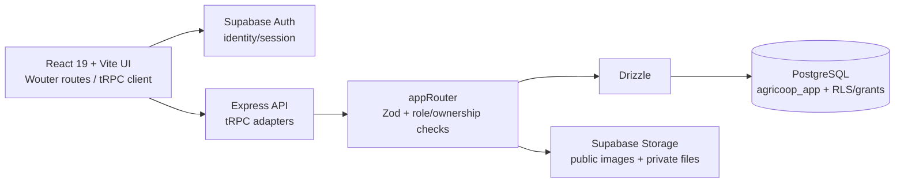

# AgriCoop Marketplace — Defense Guide

## One-page summary

AgriCoop Marketplace is a role-aware web application for cooperative-based agricultural listings and transactions. Buyers browse products, maintain a server-backed cart, place orders, request quotations, and communicate with sellers. Sellers manage their own listings and order workflow. Officer Admins (the existing `admin` role) administer their assigned cooperative; SuperAdmins have platform-level operations.

The UI is a React 19/Vite application. It calls an Express/tRPC API whose procedures validate inputs, apply application-level role and ownership checks, and use Drizzle against PostgreSQL in the `agricoop_app` schema. Supabase Auth supplies identity and Supabase Storage is used for files. The repository has code paths for a Node server and a Vercel app adapter; this guide does not claim either deployment is currently healthy.

The project implements a manual-payment workflow, not payment processing: online orders display cooperative-managed account/QR details, buyers can submit proof, and an authorized officer manually reviews it. There is no integrated payment gateway. Database policies and additive SQL are part of the design, but the latest RLS harness and newly prepared migrations have not been executed against PostgreSQL in this run.

Evidence from the latest local run: `pnpm check` passed; Vitest reported 75 test files, 431 passed tests, and 14 skipped Postgres-backed tests; `pnpm build` passed with a >500 KB chunk warning. Playwright discovered 24 desktop/mobile cases but was not run in a browser. These are repository test results, not production certification.

## Architecture and tradeoffs

- UI routes are registered in [`client/src/App.tsx`](../client/src/App.tsx); shared UI/API types are derived from the tRPC router.
- [`server/_core/app.ts`](../server/_core/app.ts) mounts Express, conversation streaming, the app tRPC router, and the system router. [`server/_core/index.ts`](../server/_core/index.ts) is the local Node entry and configures Vite in development/static files otherwise. `api/index.ts` is the Vercel adapter; deploy state is not verified here.
- [`server/_core/context.ts`](../server/_core/context.ts) creates the request context. [`server/_core/trpc.ts`](../server/_core/trpc.ts) defines public/protected procedures and request database scoping. The main runtime router is [`server/routers.ts`](../server/routers.ts); `server/routers.fixed.ts` is an unimported stale duplicate and was not deleted.
- [`drizzle/pg-schema.ts`](../drizzle/pg-schema.ts) describes PostgreSQL tables/enums in `agricoop_app`. SQL migrations are maintained separately under `supabase/migrations/`; the TypeScript schema is not proof of the live catalog.

**Tradeoffs:** A single typed API keeps UI and server contracts close and is practical for a capstone team, but couples client and server releases. PostgreSQL transactions and RLS give a useful second authorization boundary, but only when actual grants, ownership, and policies match the intended configuration. Hand-reviewed additive SQL avoids destructive schema changes; it also means local migration files can be ahead of an unverified deployment. The main Vite JavaScript chunk is currently above the build warning threshold and should be split before optimizing for slower devices.

## Feature-to-code trace

| Feature | Start here | Procedure/helper | If it broke, check |
|---|---|---|---|
| Marketplace browsing | `client/src/pages/Marketplace.tsx` | `marketplace.list` in `server/routers.ts` | Query filters, public projection, and shared purchase rule |
| Purchase eligibility | `server/marketplaceRules.ts` | `productPurchaseBlockReason` | Listing status, seller approval/deletion, minimums, reservations, fulfillment |
| Persistent buyer cart | `client/src/pages/Marketplace.tsx`, `server/cart.ts` | `cart.mine`, `cart.add`, `cart.setQuantity` | Cart owner RLS, product eligibility, refresh hydration |
| Checkout and order creation | `client/src/pages/Checkout.tsx` | `orders.create` in `server/routers.ts` | Per-seller grouping, method availability, totals, inventory and transaction errors |
| Quotation requests | `client/src/pages/ProductDetails.tsx` | `quotations.request`, `quotations.respond` | Buyer/product eligibility and purchase invariant |
| Seller's listings | `client/src/pages/Dashboard.tsx` | `products.mine`, `products.archive`, `products.softDelete` | Ownership, soft-delete, and product RLS policy |
| Cooperative association | `client/src/pages/Profile.tsx` | `cooperativeAssociations.request`, `cooperativeAdmin.reviewAssociationRequest` | Active target, pending uniqueness, reason/note, move-listings choice |
| Cooperative/Admin moderation | `client/src/pages/Dashboard.tsx` | `admin.overview`, `admin.reviewProduct`, `admin.hideListing`, `admin.deleteListing` | Officer cooperative scope and SuperAdmin scope |
| Buyer order/quotation view | `client/src/pages/Activity.tsx` | `orderArchiveProcedures`, `quotationArchiveProcedures` in `server/part2Routers.ts` | Acting-user state and dedicated `order`, `seller_order`, `quotation` channels |
| Checkout receipt and review | `client/src/pages/Checkout.tsx` | `payments.uploadCheckoutReceipt`, `payments.finalizeCheckoutReceipt`, `orders.create`, `payments.reviewProof` | Buyer/seller-bound receipt intent, byte-size and image-signature checks, assigned-cooperative reviewer, private bucket |
| System online-payment settings | `client/src/pages/PaymentOptions.tsx` | `systemPayment.*` in `server/routers.ts` | Admin/SuperAdmin authorization, active account, signed QR URL |
| Cooperative Admin application | `client/src/pages/CoopAdminApplication.tsx` | `officerApplications.*` in `server/part2Routers.ts` | Applicant ownership, private documents, approval state and notifications |
| Notifications | `client/src/components/NotificationBell.tsx` | `notifications.mine`, `notifications.markRead` | User scoping, authorized notification creation, invalidation |
| Support and private chat | `client/src/pages/Messages.tsx`, `client/src/pages/SupportTickets.tsx` | `conversations.*`, `support.*` | Participant-only trade chat vs. staff support-ticket access |

## Data model

The canonical app schema is [`drizzle/pg-schema.ts`](../drizzle/pg-schema.ts). Core relationships:

- `users` holds the application identity linked to Supabase Auth via `openId`, one of four roles, approval/verification state, cooperative association, and soft-delete fields. `cooperatives` holds active/inactive cooperative details and soft-delete metadata.
- `products` belongs to a seller and may retain its cooperative assignment; `productImages` contains image references. `cartItems` is keyed by user/product. Product and user removal is soft-delete in application flows.
- `quotations` connects buyer, seller, and product. `orders` connect buyer, seller, and cooperative; `orderItems` snapshot quantities/prices; `orderHistory` and `orderEvents` record activity.
- `payments`, `paymentProofs`, `paymentEvents`, `transactions`, `systemPaymentSettings`, and `systemOnlinePaymentAccounts` represent records and manual verification state; they are not a payment-gateway integration.
- `conversations` / `conversationMessages` carry messages. `threadStates` stores per-user inbox metadata with a `(userId, channel, threadId)` key, so archive/delete state is not shared. `supportTickets` / `supportTicketMessages` are separate staff-support records.
- `cooperativeAdminApplications` stores role applications and ID/proof object paths; `cooperativeAssociationRequests` stores seller change requests and review decisions. `notifications` and `auditLogs` record user-facing and administrative events.

## Security model and permissions

1. Supabase Auth authenticates an identity; `createContext` resolves the application user. Protected tRPC middleware requires a user, and `requireOperationalRole` rejects disallowed, suspended, pending, or unassigned operational accounts.
2. Router procedures enforce ownership, role, workflow state, and cooperative scope. `server/authz.ts` contains reusable predicates, including `canAccessConversation`, payment access checks, and managed-account role rules.
3. PostgreSQL grants, column grants, RLS policies, and trigger/function guards are intended as defense in depth. See [`docs/RLS_POLICY_MATRIX.md`](./RLS_POLICY_MATRIX.md) and [`supabase/migrations/20261117131000_marketplace_rls_grants.sql`](../supabase/migrations/20261117131000_marketplace_rls_grants.sql).
4. Signed URLs are issued only after server authorization. The private `coop-admin-applications` bucket uses Auth-user-prefixed paths; uploader and SuperAdmin access are implemented. The applicant's ID and proof images are sensitive personal information.
5. Account and listing removals use tombstones; thread archive/delete changes only the acting user's view. Audit writes are intended to be append-only and actor-pinned by database functions/policies.

| Role | Intended reach (application code) | Notable restriction |
|---|---|---|
| Anonymous | Public active marketplace/cooperative browsing | No account, order, cart, private file, or staff API |
| Buyer | Own profile, cart, orders, quotations, receipts, and conversations | Cannot operate on another buyer's records or moderate listings |
| Seller | Own profile/listings, seller orders, quotations, and participant chats | Cannot review payment proof or read other sellers' private data |
| Officer Admin (`admin`) | Assigned cooperative's sellers, listings/moderation, orders, quotations, and payment review | No cooperative means no operational access; no private buyer–seller trade-chat bypass; cannot create Admin/SuperAdmin |
| SuperAdmin | Platform-wide administrative operations, cross-cooperative review and system settings | UI does not create another SuperAdmin; self-delete and deleting another SuperAdmin are guarded |

**Verification caveat:** This is the intended role model derived from source and prepared SQL, not proof of the current production database. The real-Postgres harness did not run because `TEST_DATABASE_URL` was unavailable. The production security review also flags checking effective database identity, `BYPASSRLS`, table ownership, grants, Storage, and Auth configuration as deployment gates.

### Philippine Data Privacy Act and ID images

Republic Act No. 10173 (the Philippine Data Privacy Act of 2012) is relevant because the system stores account details, contact information, and identity/proof images. This guide is not legal advice and does not certify DPA compliance. A cooperative/project operator should document the lawful basis and purpose, provide an appropriate privacy notice, minimize collection, restrict access, set retention/deletion rules, secure processors and transfers, honor data-subject rights, and establish breach handling with a qualified privacy officer/counsel.

Cooperative Admin applicants upload ID and proof-of-position images to the private `coop-admin-applications` bucket. Paths are prefixed with the Auth user ID; server authorization gates signed URLs for the uploader and SuperAdmin. These protections do not answer how long files are retained, whether every deployed bucket policy is correct, or how a user exercises a deletion/access request. Verify those in an approved environment before collecting real documents. Never place ID images, signed URLs, or credentials in logs, screenshots, test output, or this guide.

## Engineering incident and defect history

The repository does not document a confirmed data breach. These are documented defects/operational blockers, not claims of security incidents:

| Defect | Evidence and correction | Remaining proof gap |
|---|---|---|
| Listing eligibility differed between browse, cart, checkout, and quotations | Stage 1 centralized the purchasability rule in `server/marketplaceRules.ts`; Stage 2b added a test that every `marketplace.list` result can pass cart, checkout, and quote steps | The invariant test is mocked; live DB/RLS and race behavior remain unverified |
| `seller_order` / `quotation` channel values could violate a deployed CHECK constraint; reusing `order` / `support` could collide across object IDs | Stage 2b restored dedicated channels and added BLOCK 30 with a catalog preview | Migration and current live CHECK constraint have not been checked |
| Admin account removal tried to delete another user's owner-only cart rows; Auth ban errors could be ignored | Stage 2 retains cart rows with user tombstone and propagates Auth ban/unban failure | Actual Auth/RLS behavior not run against live services |
| Add-account provisioning returned 504 when opening nested request DB scopes | Stage 2 excluded that route from the outer middleware scope; nested-scope test inventories exceptions | Deployed pool behavior not measured |
| Listing images fell back to the marketing hero when a transformed Storage URL returned 403 | `docs/UX_DECISIONS.md` records the root cause and shared URL resolution fix | No production URL inventory was queried in this run |
| The mobile menu expanded in document flow and shifted page content | Replaced by a fixed shared overlay with focus and dismissal behavior | No fresh screen-reader audit was run |
| Historical registration could expose an inactive-account message for duplicate signup | Stage 0 restored a generic response and isolated rate-limiter test IPs | Live Auth error behavior not tested |

## Quality evidence, limitations, and follow-up

- Latest: Node 22.23.5; TypeScript check passed; 75 Vitest files passed, 431 tests passed and 14 skipped; build passed. The largest reported client JS chunk is about 793 KB minified, above Vite's 500 KB warning threshold.
- `server/dbHarness.rls.test.ts` contains database-backed role/RLS checks and refuses non-local test hosts. Its 14 skipped cases are **not verified** here.
- `e2e/stage-fixes.spec.ts` contains 24 discovered desktop/mobile browser cases. Discovery is not execution; no app session or QA account was used.
- No payment gateway is integrated. GCash/online payment proof is manually reviewed; offline pickup/delivery payment is manually recorded.
- Production migrations, RLS/grants, Supabase bucket visibility/policies, Auth email configuration, Vercel behavior, backup/restore, and performance under realistic load were not verified in this run.
- Supabase/Vercel free-tier quotas and the current billing plan were not inspected. Storage, bandwidth, function, database, and email-provider quotas may constrain usage; confirm current plan limits with the project owner.
- Before release, review the previews in `docs/MANUAL_SQL.md`, apply migrations only through the user's approved process, run the disposable-local Postgres harness and Playwright suite, and collect effective-role/RLS and Storage evidence. No push or deploy was performed.

## Panel questions and honest answers

1. **What problem does AgriCoop address?** It provides a shared online catalog and workflow for cooperative-based agricultural sales; impact on income or adoption has not been measured.
2. **Who uses it?** Buyers, Sellers, Officer Admins, and SuperAdmins.
3. **Is Cooperative Admin a fifth role?** No. It is an application/display term; the operational `admin` role is shown as Officer Admin.
4. **What is the main buyer journey?** Browse, add to cart, choose fulfillment/payment options, place an order, and optionally request quotations or message the seller.
5. **What does the Seller do?** Maintain listings, respond to quotations, and confirm/prepare orders within permitted transitions.
6. **What does an Officer Admin do?** Manage listings and order/payment operations for the assigned cooperative, subject to the procedure checks.
7. **What does the SuperAdmin do?** Platform-level cooperative, application, account, payment-setting, and audit operations.
8. **What is the contribution of the project?** An implemented, role-aware cooperative marketplace workflow; the repository does not contain a controlled study proving economic outcomes.
9. **Why use a single app/API instead of microservices?** It reduces deployment and coordination overhead for this project; independent scaling and isolation are tradeoffs not yet needed or tested.
10. **Why React and Vite?** They provide the existing client build and component workflow; the project uses React 19 with lazy route components.
11. **Why tRPC?** It shares TypeScript procedure/input/output contracts between client and server; it couples frontend and backend changes.
12. **Where does the API run?** The code has Express Node and Vercel adapter entry points; the current deployment and runtime health were not verified.
13. **Where is the authorization logic?** In protected tRPC middleware, per-procedure checks, reusable predicates in `server/authz.ts`, and intended database RLS/grants.
14. **Which database schema is used?** PostgreSQL schema `agricoop_app`, described in `drizzle/pg-schema.ts`.
15. **How is a login identity connected to app data?** The application user row stores an Auth-linked `openId`; request context resolves it before protected operations.
16. **How do you prevent a bad listing from being purchasable?** Marketplace, cart, order, and quote paths share `productPurchaseBlockReason`.
17. **What conditions does that rule consider?** Listing/seller eligibility, stock after reservations, minimum quantity, and compatible fulfillment.
18. **Why is the cart server-backed?** So refresh and checkout use the same persisted buyer cart; local leftovers are merged at login.
19. **How are order totals calculated?** Server-side from product and quantity inputs; clients do not authoritatively set the final total.
20. **How do you handle multiple sellers in one cart?** The checkout groups items by seller and creates a separate order per group.
21. **What happens when stock changes during checkout?** The server rechecks eligibility/inventory before writing; database race/isolation behavior has not been proven by the skipped Postgres harness.
22. **What does a quotation do?** It stores a buyer's request and seller response; accepted quotations can enter the order path with rule checks.
23. **Can archived orders be deleted from the database?** Buyer-facing removal is per-user view state; order business records remain.
24. **What prevents buyer archive state from hiding the seller's order?** `threadStates` is keyed by user and dedicated channel; database verification remains pending.
25. **Are payments processed online?** No gateway is integrated; the app records manual payment states and proof.
26. **How is an online payment verified?** A buyer submits proof and an authorized cooperative officer/SuperAdmin reviews it; this is a human process.
27. **Where does the online-payment QR come from?** From cooperative/platform-managed payment settings, not a seller's private payment columns.
28. **What happens if a payment method is disabled?** Checkout disables it and displays the reason, then validates availability again on submission.
29. **Can Sellers approve payment receipts?** No; Seller payment status is read-only and proof review is reserved for authorized staff.
30. **How does a Seller change cooperative?** Submit a reasoned request for an active cooperative; a staff reviewer decides and can explicitly opt to move existing listings.
31. **Can a Seller have two pending association requests?** No; both application checks and a partial unique index are intended to enforce one pending request.
32. **What if a cooperative changes?** Existing listings keep their cooperative unless the approver selects the move option.
33. **How does Officer Admin scope work?** Procedures use the assigned cooperative; `requireOperationalRole` also rejects an unassigned Admin.
34. **Can Admin see private trade chats?** No; `canAccessConversation` limits seller-linked trade chats to participants. Support is a separate workflow.
35. **What does soft delete mean here?** Rows are retained and marked with deletion metadata; user login/re-registration and staff restore paths are guarded in code.
36. **What stops a Seller from forging `deletedBy`?** The design uses narrow column grants and a database guard; execution against the actual database is still required.
37. **Is RLS the only authorization layer?** No. Application procedures also validate role, ownership, state, and cooperative scope.
38. **Has production RLS been proven?** No. The production database role, `BYPASSRLS`, table ownership, grants, and policies were not inspected in this work.
39. **How are private ID documents protected?** Private bucket, Auth-user-prefixed paths, and server-side authorization before issuing a signed URL; live bucket settings remain unverified.
40. **Who can view Cooperative Admin application documents?** The uploader and SuperAdmin through the authorized application flow; not ordinary Buyers, Sellers, or Officer Admins.
41. **How are passwords stored?** Authentication is delegated to Supabase Auth; the application does not implement its own password database.
42. **How are admin changes audited?** `auditLogs` and database write helpers record administrative events; retention and deployed policy behavior require verification.
43. **How are notifications delivered?** The app stores in-app notifications. Application decisions do not imply a separate transactional email provider.
44. **How are database changes deployed?** Additive SQL migrations with previews are documented in `docs/MANUAL_SQL.md`; they were not run by this session.
45. **Why avoid destructive migrations?** Existing user/order history must remain intact, and the project owner explicitly reviews and runs changes.
46. **What does the test suite prove?** Mock/unit contracts and source-level behavior described by each test; it does not prove production configuration.
47. **What were the latest test counts?** 431 Vitest tests passed and 14 were skipped across 75 files.
48. **Why were tests skipped?** The real-Postgres harness requires `TEST_DATABASE_URL`, which was not available.
49. **Were the Playwright tests run?** No. Twenty-four cases were discovered for desktop/mobile projects, but no browser was launched.
50. **Was the full app security-tested?** No. A read-only code review found no confirmed exploitable vulnerability in its reviewed scope; it did not validate live infrastructure.
51. **What was the image defect?** A transformed Storage URL returned 403 and fell back to the hero image; shared resolution was changed to preserve supported object URLs.
52. **What caused the add-account timeout?** A nested request database scope; middleware scope exclusions were added and a static regression test covers scope boundaries.
53. **What was the archive-channel issue?** Some channel strings conflicted with the existing CHECK constraint, while shared IDs across channels risked hiding unrelated records; dedicated channels and an additive migration address it.
54. **How do mutation errors differ from load errors?** Query/load failures retain load wording; mutations use action-specific messages and a reference code.
55. **Does a passing build mean deployment is safe?** No. It proves the local artifacts compile, not database, Auth, Storage, or Vercel configuration.
56. **Does the project conform to WCAG?** No conformance claim is made; `docs/ACCESSIBILITY.md` lists tested behavior and gaps.
57. **How is mobile checkout accessed?** The marketplace provides a "Your order" button and sheet when the desktop card is out of view.
58. **What is the largest technical limitation?** The manual payment workflow and unverified production database/security configuration are important operational limits.
59. **How does the system scale?** It uses a conventional relational database and a single application API; realistic load testing and a scaling study have not been done.
60. **What are the free-tier constraints?** The current plans were not inspected; database, storage, bandwidth, function, and email quotas must be confirmed with the owners.
61. **What is the next release gate?** Review SQL previews, run migrations in approved staging, execute RLS and browser tests, and verify effective grants and private buckets before promotion.
62. **How does the Philippine Data Privacy Act apply?** Personal and identity data require a documented lawful basis, notice, purpose limits, safeguards, retention and rights handling; this guide is not a compliance determination.
63. **Why collect an ID image?** It supports the Cooperative Admin application workflow; the project should minimize data, explain the purpose, and define retention before production collection.
64. **How do you measure success?** Track task completion, listing/order success, error rates, and cooperative adoption in a consent-aware study; no such outcome dataset is claimed here.
65. **What should you say if a panel asks about an unrun check?** State that it is unverified, name the exact harness or local command, and do not describe source-level tests as live proof.

## 15 "show me in the code" challenges

1. Show the four-role enum in [`drizzle/pg-schema.ts`](../drizzle/pg-schema.ts) and explain why Cooperative Admin applicants are not a fifth role.
2. Show Supabase identity resolution in [`server/_core/context.ts`](../server/_core/context.ts).
3. Show the public/protected procedure middleware in [`server/_core/trpc.ts`](../server/_core/trpc.ts).
4. Show operational role and suspension checks in [`server/authz.ts`](../server/authz.ts), `requireOperationalRole`.
5. Show the shared purchase predicate in [`server/marketplaceRules.ts`](../server/marketplaceRules.ts), `productPurchaseBlockReason`.
6. Show `marketplace.list` and its result shaping in [`server/routers.ts`](../server/routers.ts).
7. Show the server-backed cart procedures in [`server/cart.ts`](../server/cart.ts).
8. Show `orders.create`, seller grouping, and server validation in [`server/routers.ts`](../server/routers.ts).
9. Show `quotations.request` and explain how a quotation can become an order.
10. Show `cooperativeAssociations.request` and its distinct ineligible reasons in [`server/cooperativeAssociations.ts`](../server/cooperativeAssociations.ts).
11. Show `cooperativeAdmin.reviewAssociationRequest` and the optional listing move in [`server/routers.ts`](../server/routers.ts) and migration `20261118220000_cooperative_association_listing_move.sql`.
12. Show per-user archive state in [`server/part2Routers.ts`](../server/part2Routers.ts) and explain why channels are separate.
13. Show the `shares_cooperative` product policy in [`supabase/migrations/20261117131000_marketplace_rls_grants.sql`](../supabase/migrations/20261117131000_marketplace_rls_grants.sql); explain why it still needs live effective-role validation.
14. Show the private application document authorization and signed-URL path in [`server/part2Routers.ts`](../server/part2Routers.ts), `officerApplications.documentUrl`.
15. Show the real-Postgres harness and its local-host safety checks in [`server/dbHarness.rls.test.ts`](../server/dbHarness.rls.test.ts); distinguish skipped from passed cases.
