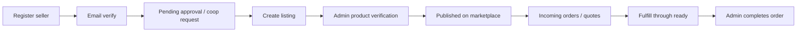

# AgriCoop Marketplace — UX Audit

**Scope.** This audit compares AgriCoop’s implemented client routes and UI (`client/src/App.tsx`, `client/src/components/AgriShell.tsx`, and listed page modules) against expectations for a Shopee/Lazada-style cooperative marketplace. It is grounded in code as of the recent shell, search, error-handling, and auth-reconciliation pass—not in hypothetical screens.

**Roles in product copy vs code.**

| Product term | Route / `user.role` | Primary workspace |
|--------------|---------------------|-------------------|
| Buyer | `buyer` | `/dashboard` → `BuyerDashboard` |
| Farmer / Seller | `seller` | `/dashboard` → `SellerVerificationWorkspace` |
| Cooperative officer | `admin` | `/dashboard` → `AdminDashboard` (scoped) |
| System administrator | `superadmin` | `/dashboard` → `AdminDashboard` (platform-wide) + reconciliation tools |

**Route inventory.**

| Path | Page | Shell |
|------|------|-------|
| `/` | `Home` | `PageFrame` |
| `/about` | `About` | `PageFrame` |
| `/auth` | `Auth` | `PageFrame` |
| `/marketplace` | `Marketplace` | `PageFrame` |
| `/products/:id` | `ProductDetails` | `WorkspaceHeader` only (no `PageFrame`) |
| `/checkout` | `Checkout` | `PageFrame` |
| `/activity` | `Activity` | `WorkspaceHeader` |
| `/dashboard` | `Dashboard` (role branch) | `WorkspaceHeader` / `AuthGate` |
| `/support` | `Support` | `WorkspaceHeader` |
| `/support-tickets` | `SupportTickets` | `WorkspaceHeader` |
| `/reports` | `Reports` | `WorkspaceHeader` |
| `/admin/payment-options` | `PaymentOptions` | `WorkspaceHeader` |
| `/admin/audit-logs` | `AuditLogs` | `WorkspaceHeader` |

There is **no** `/cart` route; basket state lives on `/marketplace` in the `#order` aside panel and in `sessionStorage` for checkout.

---

## Recent platform fixes (this pass)

| Fix | Where it shows up in UX |
|-----|-------------------------|
| **Full-width shell** `agri-shell` / `--agri-content-max: 1600px` + full-bleed bands | Shared `.agri-shell`; hero is true 2-col grid; glass badge bottom-right; marketplace banner is viewport-wide without negative-margin hacks |
| **Header marketplace search** | `MarketplaceSearch` in `PublicHeader` (desktop inline, mobile second row); syncs `?q=` on `/marketplace` |
| **Mobile bottom navigation** | `MobileBottomNav` on `PageFrame` only (`md:hidden`, 5 tabs) |
| **`toUserFacingErrorMessage`** (no raw SQL) | `shared/userFacingErrors.ts`; `Marketplace` load failure, `Dashboard` `QueryErrorState`, `RoleConflictsPanel` reconcile errors |
| **`RoleConflictsPanel` (SuperAdmin)** | System administration block on `/dashboard` |
| **Self-heal role sync on login** | Server: single user + single profile conflict → sync profile to app role (`server/db.ts`); UI still blocks until resolved if heal fails |
| **`orders.demoSeedKey` migration** | Schema/seed stability (reduces order query failures that previously surfaced as cryptic UI errors) |

---

## 1. Global shell and navigation (`AgriShell`)

| Screen | Element | Expected (marketplace standard) | Actual | Verdict | Fix applied |
|--------|---------|----------------------------------|--------|---------|-------------|
| Shell | Content max width | Consistent grid on large displays | `mx-auto w-full max-w-[1440px]` on header, footer, and marketplace main | Makes sense | Yes — `SHELL` constant |
| Public header | Product search | Persistent search (Lazada/Shopee) | `MarketplaceSearch` in header; submits to `/marketplace?q=` | Makes sense | Yes — header search |
| Public header | Cart entry | Obvious cart with count | Basket icon → `/marketplace#order` (no badge count) | Makes sense (coop product) | Partial — hash target exists; count not shown |
| Public header | Account | Sign in / account menu | Join → auth; signed-in → Account + notifications + logout (desktop) | Makes sense | — |
| Mobile nav | Five primary actions | Home, browse, cart, orders, account | `MobileBottomNav`: Home, Browse, Cart, Orders, Account | Makes sense | Yes — bottom nav added |
| Mobile nav | Cart deep link | Opens basket panel | `Cart` item sets `hash: "order"` in data but `Link` uses only `href="/marketplace"` (hash unused) | Fix needed | No — user lands on marketplace top, not basket |
| Workspace header | Role-aware links | Relevant shortcuts per role | Browse, Support; Orders (buyer/seller); Reports + Audit (admin/superadmin) | Makes sense | — |
| Footer | Payment expectation | Clear payment model | States F2F coordination, not online escrow | Makes sense | Accepted constraint (F2F) |
| Notifications | Unread badge + links | Actionable alerts | Bell dropdown, mark read, deep link or `/dashboard` fallback | Makes sense | — |

---

## 2. Public discovery

### Home (`/`)

| Screen | Element | Expected | Actual | Verdict | Fix applied |
|--------|---------|----------|--------|---------|-------------|
| Home | Hero CTA | Path to catalog | “Explore fresh listings” → `/marketplace` | Makes sense | — |
| Home | Role education | Who the product serves | Four role cards (buyers, farmers, officers, admins) | Makes sense | — |
| Home | Layout width | Align with shell | Sections use `max-w-7xl` inside `PageFrame` (slightly narrower than 1440 shell) | Makes sense | — |

### About (`/about`)

| Screen | Element | Expected | Actual | Verdict | Fix applied |
|--------|---------|----------|--------|---------|-------------|
| About | Journey explanation | Onboarding narrative | Four steps: join → list/discover → quote/order → F2F payment record | Makes sense | Accepted constraint (F2F, quotations) |
| About | CTA | Return to shopping | “Visit marketplace” → `/marketplace` | Makes sense | — |

---

## 3. Authentication (`/auth`)

| Screen | Element | Expected | Actual | Verdict | Fix applied |
|--------|---------|----------|--------|---------|-------------|
| Auth | Registration roles | Buyer vs seller self-serve | Select buyer or seller; admin not self-registered | Makes sense | — |
| Auth | Email verification gate | Block until verified | Supabase confirmation + resend flow | Makes sense | — |
| Auth | Post-login routing | Role workspace | Success → `/dashboard` after `auth.me` resolves | Makes sense | — |
| Auth | Role conflict UX | Actionable recovery | Toast + message references SuperAdmin **Role reconciliation**; server attempts self-heal when exactly one app user and one profile disagree | Makes sense | Yes — self-heal + `RoleConflictsPanel` |
| Auth | Error surfacing | No internal DB strings | Supabase/toast messages; resolution codes via `auth.status` | Makes sense | Partial — not all surfaces use `toUserFacingErrorMessage` |

---

## 4. Buyer journey

### Marketplace (`/marketplace`)

| Screen | Element | Expected | Actual | Verdict | Fix applied |
|--------|---------|----------|--------|---------|-------------|
| Marketplace | Listing grid | Filter, sort, search | Category + price sort (server); client filter on `q` and local search on mobile | Makes sense | Yes — `q` from header search |
| Marketplace | Add to cart | One-click add | Add with min qty; single-seller basket rule; auth + approval gates | Makes sense | Accepted constraint (one farmer per order) |
| Marketplace | Quotation (B2B) | Optional pre-order pricing | Modal: qty, note, estimated total; seller responds before order | Makes sense | Accepted constraint (quotation path) |
| Marketplace | Cart panel | Sticky cart / drawer | Right aside `#order`; payment method cash pickup/delivery; continue → checkout | Makes sense | Accepted constraint (no `/cart` route) |
| Marketplace | Load errors | User-safe message | Dedicated error UI with `toUserFacingErrorMessage` + retry | Makes sense | Yes |
| Marketplace | Guest browse | Browse without login | Listings visible; trade actions → `goToAuth` | Makes sense | — |

### Product details (`/products/:id`)

| Screen | Element | Expected | Actual | Verdict | Fix applied |
|--------|---------|----------|--------|---------|-------------|
| Product details | Purchase actions | Add to cart / buy now on PDP | Only “Return to order” → `/marketplace` (no direct add/quote) | Fix needed | No — extra step vs marketplace norm |
| Product details | Shell consistency | Same nav as catalog | `WorkspaceHeader` only; **no** `PageFrame` / mobile bottom nav | Fix needed | No |
| Product details | Gallery | Multi-image | Thumbnail strip when multiple URLs | Makes sense | — |
| Product details | Errors | Safe messages | `error.message` shown on failure (not sanitized) | Fix needed | No — should use `toUserFacingErrorMessage` |

### Checkout (`/checkout`)

| Screen | Element | Expected | Actual | Verdict | Fix applied |
|--------|---------|----------|--------|---------|-------------|
| Checkout | Cart persistence | Survive navigation | `sessionStorage` + `checkoutCartSchema` | Makes sense | — |
| Checkout | Payment methods | Cash + optional digital | Cash pickup/delivery + GCash with cooperative QR options | Makes sense | Accepted constraint (manual GCash verification) |
| Checkout | Success path | Order confirmation view | Toast + redirect to `/dashboard` (not dedicated confirmation page) | Makes sense (coop) | — |
| Checkout | Empty cart | Recovery | Message + link back to marketplace | Makes sense | — |

### Activity (`/activity`) — buyer/seller outgoing view

| Screen | Element | Expected | Actual | Verdict | Fix applied |
|--------|---------|----------|--------|---------|-------------|
| Activity | Orders + quotes | Unified “my purchases” | Two columns: outgoing orders and quotation requests | Makes sense | — |
| Activity | Access control | Role gate | Non buyer/seller see explanation card | Makes sense | — |
| Activity | Errors | Safe messages | Raw `ordersError` / `quotationsError` message in alert strip | Fix needed | No |

### Dashboard — buyer (`/dashboard`, `BuyerDashboard`)

| Screen | Element | Expected | Actual | Verdict | Fix applied |
|--------|---------|----------|--------|---------|-------------|
| Buyer dashboard | Order tracking | Status timeline | Order cards with status pills; link to browse | Makes sense | — |
| Buyer dashboard | Quotation decisions | Accept/decline → order | Responded → accept/decline; accepted → place order at quoted price (cash only) | Makes sense | Accepted constraint |
| Buyer dashboard | Profile verification | KYC upload | `ProfileVerificationPanel` with private storage upload | Makes sense | — |
| Buyer dashboard | GCash proofs | Receipt upload | `BuyerPaymentProof` per GCash order | Makes sense | — |
| Buyer dashboard | Query errors | Safe messages | `QueryErrorState` + `toUserFacingErrorMessage` | Makes sense | Yes |

---

## 5. Seller (farmer) journey

### Dashboard — seller (`/dashboard`, `SellerVerificationWorkspace`)

| Screen | Element | Expected | Actual | Verdict | Fix applied |
|--------|---------|----------|--------|---------|-------------|
| Seller dashboard | Listing CRUD | Create, edit, archive | Inline forms; verification submit; admin approval before visibility | Makes sense (coop governance) | — |
| Seller dashboard | Cooperative association | Join a coop | `SellerAssociationRequestPanel` when `cooperativeId === null` | Makes sense | — |
| Seller dashboard | Fulfillment | Status workflow | submitted → confirmed → ready; record cash; officer completes | Makes sense | Accepted constraint (officer completes) |
| Seller dashboard | Quotations | Reply to buyers | Price + note or decline | Makes sense | Accepted constraint (B2B) |
| Seller dashboard | Pending approval gate | Clear blocked state | `AuthGate` pending/suspended screens | Makes sense | — |

### Marketplace (seller as buyer)

Sellers with approval may also buy from other farmers (same gates as buyers on `Marketplace` and `Checkout`). UI labels them “Farmer” in places but `canTrade` includes `seller` role.

---

## 6. Admin (cooperative officer) journey

### Dashboard — admin (`/dashboard`, `AdminDashboard`)

| Screen | Element | Expected | Actual | Verdict | Fix applied |
|--------|---------|----------|--------|---------|-------------|
| Admin dashboard | Member-focused overview | Coop KPIs + member table | **Not routed:** `OfficerDashboard` exists in file but is unused; admins get full `AdminDashboard` | Fix needed (product) | No — accepted as consolidated admin UX for capstone |
| Admin dashboard | Association requests | Approve seller coop link | `AssociationRequestsManager` | Makes sense | — |
| Admin dashboard | Product verification | Approve listings | Queue with approve/reject + reason | Makes sense | — |
| Admin dashboard | Order fulfillment | Complete with adjusted qty | `AdminOrderCard` modal for final quantities | Makes sense | — |
| Admin dashboard | GCash review | Verify proofs | `AdminPaymentReviewQueue` | Makes sense | — |
| Admin dashboard | Profile verification | Review ID docs | `AdminProfileVerificationQueue` | Makes sense | — |
| Admin dashboard | User management | Role/approval/coop | Inline table edits (no superadmin assign unless superadmin) | Makes sense | — |
| Admin dashboard | Act as seller | Support testing | Toggles embedded `SellerDashboard` | Makes sense | — |

### Payment options (`/admin/payment-options`)

| Screen | Element | Expected | Actual | Verdict | Fix applied |
|--------|---------|----------|--------|---------|-------------|
| Payment options | CRUD + QR | Configure checkout GCash | Create/edit/delete, upload QR, active flag | Makes sense | — |
| Payment options | Scope | Coop vs platform | Admin: own coop; SuperAdmin: platform-wide or per coop | Makes sense | — |
| Payment options | Access gate | Restricted roles | Pending admin blocked via `getAccountAccessRestriction` | Makes sense | — |

### Reports (`/reports`)

| Screen | Element | Expected | Actual | Verdict | Fix applied |
|--------|---------|----------|--------|---------|-------------|
| Reports | CSV exports | Sales, inventory, quotes, transactions | Four download cards; admin uses coop overview; superadmin platform overview | Makes sense | — |
| Reports | Access | Officer + superadmin only | Others see gate card | Makes sense | — |

### Audit logs (`/admin/audit-logs`)

| Screen | Element | Expected | Actual | Verdict | Fix applied |
|--------|---------|----------|--------|---------|-------------|
| Audit logs | Filterable table | Compliance trail | Action + entity filters, 50 rows, coop scope for admin | Makes sense | — |
| Audit logs | Errors | Safe messages | Raw `query.error.message` | Fix needed | No |

### Support (`/support` vs `/support-tickets`)

| Screen | Element | Expected | Actual | Verdict | Fix applied |
|--------|---------|----------|--------|---------|-------------|
| Support | Conversations | Chat with support | Thread list + SSE refresh; new inquiry form | Makes sense | — |
| Support tickets | Ticket system | Structured tickets | Categories, priority, coop queue; staff assign/status | Makes sense | — |
| Support tickets | Discoverability | One support entry | Header links `/support`; mobile menu adds tickets; no header link to tickets for desktop | Fix needed | No — dual paths may confuse users |

---

## 7. SuperAdmin journey

SuperAdmin uses the same `AdminDashboard` with broader data scope, plus:

| Screen | Element | Expected | Actual | Verdict | Fix applied |
|--------|---------|----------|--------|---------|-------------|
| Dashboard | Role reconciliation | Fix auth conflicts | `RoleConflictsPanel`: list conflicts, align profile↔app or override | Makes sense | Yes |
| Dashboard | Create cooperative | Platform structure | Form: name + location | Makes sense | — |
| Dashboard | Assign superadmin | Dangerous role | `AdminUserRow` shows SuperAdmin option only when `canAssignSuperAdmin` | Makes sense | — |
| Payment options | Platform scope | Global QR methods | Cooperative selector on create | Makes sense | — |
| Audit / reports | Platform-wide | Cross-coop visibility | Copy + unscoped queries for superadmin | Makes sense | — |

---

## Journey flow analysis

### Buyer (happy path)

```mermaid
flowchart LR
  A[Home / Marketplace] --> B{Signed in?}
  B -->|No| C[/auth]
  C --> D{Approved buyer?}
  B -->|Yes| D
  D -->|Pending| E[Dashboard gate]
  D -->|Yes| F[Browse / marketplace]
  F --> G[Add to basket or Quote]
  G --> H[Checkout]
  H --> I[Dashboard orders / GCash proof]
  G -->|Quote| J[Seller responds]
  J --> K[Accept quote / place order]
```

**Strengths.** Clear discovery → basket → checkout; quotation path documented in UI; post-order payment proof for GCash.

**Gaps / dead ends.**

1. **PDP dead-end for purchase:** `/products/:id` does not add to cart; buyers must return to marketplace (friction vs Shopee PDP).
2. **Mobile cart tab:** Bottom nav “Cart” does not scroll/open `#order` panel.
3. **Post-checkout:** Redirect to dashboard rather than `/activity` or order detail—buyers must learn two order views (dashboard vs activity).
4. **Dual support channels:** `/support` (conversations) vs `/support-tickets` without unified entry in desktop header.

**Resolved in this pass vs constraints.**

| Item | Resolution |
|------|------------|
| Narrow layout / search only on marketplace page | Fixed: 1440px shell + header search |
| SQL errors on marketplace load | Fixed: `toUserFacingErrorMessage` |
| Role conflict blocks login | Mitigated: server self-heal + SuperAdmin panel |
| Order query failures from missing `demoSeedKey` | Fixed: migration |

| Item | Accepted product constraint |
|------|----------------------------|
| Cash F2F primary; app records coordination | By design in copy and checkout |
| No dedicated `/cart` route; basket on marketplace | By design |
| Quotations as optional B2B step | By design |
| Single-seller cart | Cooperative bulk-trade rule |

---

### Seller (happy path)



**Strengths.** Verification and admin approval align with cooperative accountability; association request flow when unassigned.

**Gaps.**

1. **Officer completion dependency:** Sellers see “ready for cooperative officer to complete”—correct but requires admin training (not a UI bug).
2. **`OfficerDashboard` unused:** Lighter “member validation only” UI is not exposed; admins always see heavy dashboard (acceptable capstone consolidation).

---

### Admin / cooperative officer

**Primary loop:** `/dashboard` → verify products/profiles/payments → complete ready orders → export `/reports` → optional `/admin/audit-logs`.

**Gaps.**

1. **No separate officer home:** `OfficerDashboard` component is dead code; officers use same surface as superadmin with reduced scope (data layer scoping, not a distinct IA).
2. **Audit / activity errors:** Raw API messages in a few places.

**Strengths.** Fulfillment modal with final quantities matches agricultural partial-delivery reality; GCash proof queue matches manual payment model.

---

### SuperAdmin

**Primary loop:** User/cooperative management → `RoleConflictsPanel` when auth drift → platform reports and audit.

**Strengths.** Reconciliation UI pairs with login self-heal; explicit copy that `users.role` is operational source of truth.

**Gaps.** None critical for capstone; platform-wide ticket queue depends on staff using `/support-tickets`.

---

## Fix backlog summary

| ID | Screen | Issue | Status this pass |
|----|--------|-------|------------------|
| UX-01 | Mobile bottom nav | Cart tab ignores `#order` hash | **Resolved** (`/marketplace#order`) |
| UX-02 | Product details | No add-to-cart / quote on PDP | **Mitigated** (basket / browse CTAs + sticky mobile bar; basket remains marketplace-owned) |
| UX-03 | Product details | Missing `PageFrame` / mobile nav | Open (WorkspaceHeader retained; sticky CTA added) |
| UX-04 | Product details / Activity / Audit | Raw error messages | **Resolved** for Product details + Activity via `toUserFacingErrorMessage` |
| UX-05 | Support IA | Two support systems, uneven header links | Open (accepted dual model: chat vs tickets) |
| UX-06 | Dashboard routing | `OfficerDashboard` not used | Open (accepted consolidation) |
| UX-07 | Activity orders | No marketplace status tabs | **Resolved** (To Pay / To Ship / To Receive / Completed / Cancelled) |
| Shell / search / role heal / schema | See “Recent platform fixes” | — | **Resolved** |

---

## Evaluation against marketplace “north star”

AgriCoop intentionally **does not** replicate Shopee/Lazada checkout automation (wallet, escrow, ship-ready cart everywhere). It **does** replicate discover → compare → basket → checkout → order history, with cooperative overlays: verification, quotations, F2F cash, GCash proof review, and officer-mediated completion.

For capstone documentation, treat remaining “fix needed” rows as **prioritized polish** unless they conflict with stated cooperative constraints above.

---

## References (implementation)

- Routes: `client/src/App.tsx`
- Shell, search, mobile nav: `client/src/components/AgriShell.tsx`
- User-facing errors: `shared/userFacingErrors.ts`
- Auth self-heal: `server/db.ts` (`getUserByVerifiedAuthId`)
- Role reconciliation API: `trpc.admin.listRoleConflicts`, `trpc.admin.reconcileRole` (UI in `RoleConflictsPanel`)
- Schema: `orders.demoSeedKey` — `supabase/migrations/20261117150000_orders_demo_seed_key.sql`